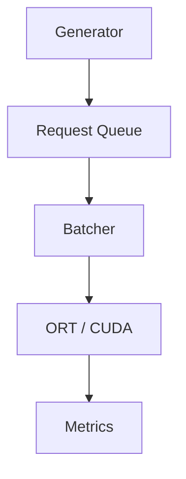
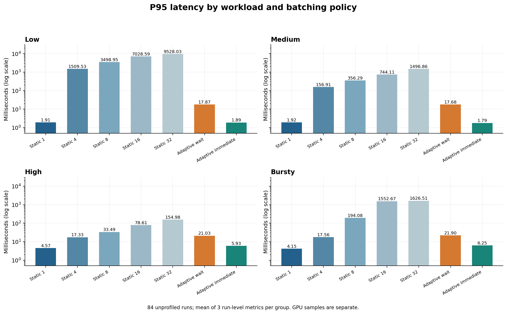
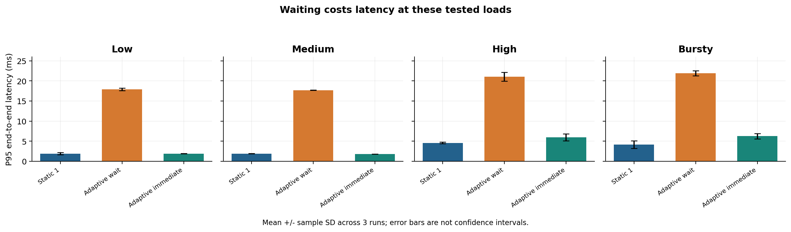
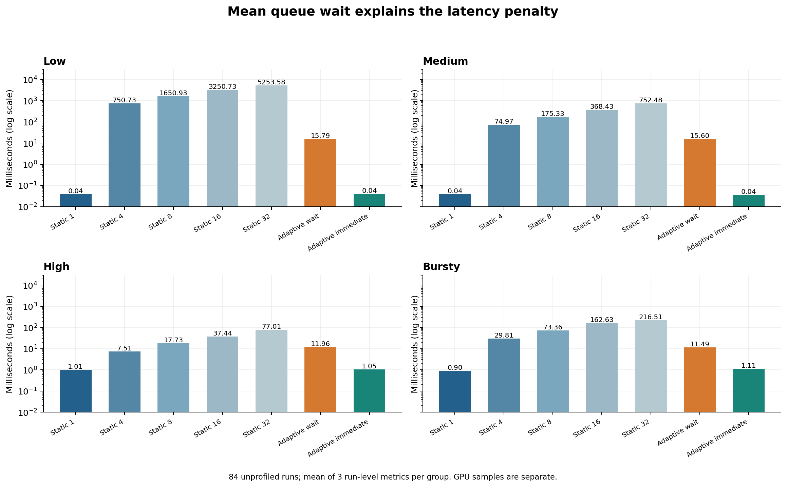
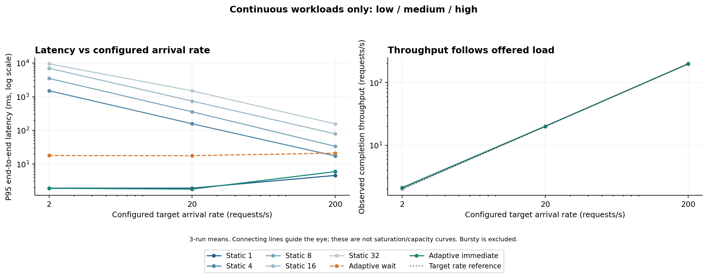
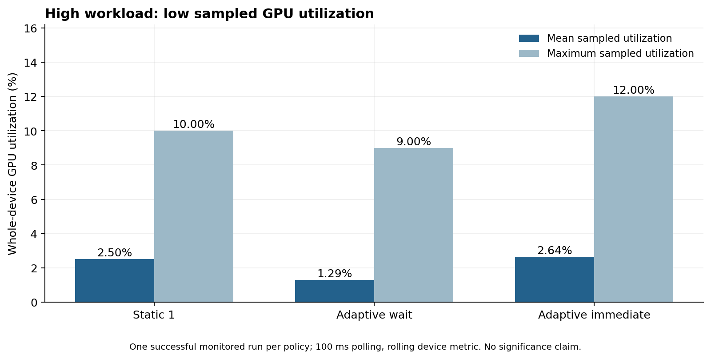
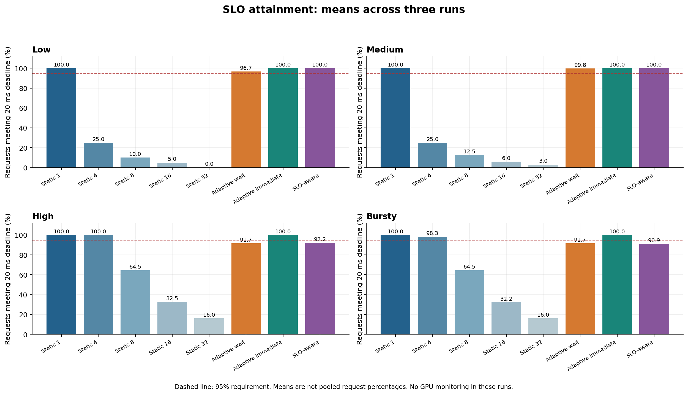
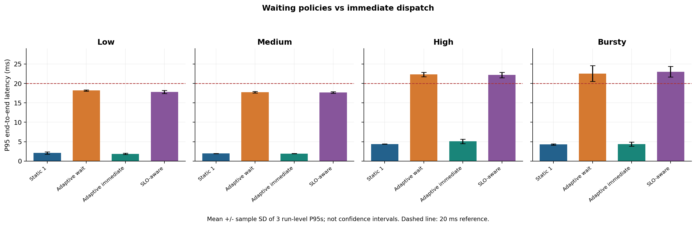
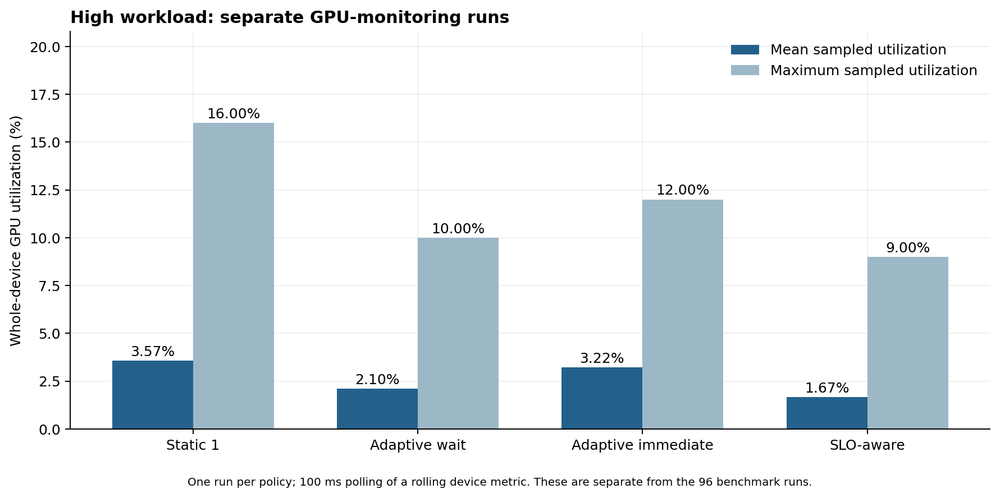

# Adaptive Batching for GPU Inference

A C++17 GPU inference serving experiment comparing static batching, two queue-aware adaptive policies, and a deadline-based SLO-aware policy.

**Status:** Initial implementation, 84-run comparison, GPU monitoring, and result analysis completed. The SLO-aware extension (separate 96-run comparison and four-policy GPU monitoring) is also completed. A ResNet-50 extension is planned and **not yet implemented**.

## Overview

Batching can improve inference efficiency, but waiting to assemble a batch also increases request latency.

This project explores that trade-off using a small wafer-defect CNN, ONNX Runtime with CUDA, and four synthetic request workloads.

The main finding is that adaptive policies reduced long batch-formation delays relative to large static batches, but did not consistently outperform Static batch 1 at the tested arrival rates.

## Research Question

Under what workload conditions does adaptive batching outperform static batching, and how does batch-formation delay affect tail latency, throughput, and GPU utilization?

## Serving Pipeline

A producer thread generates requests and places them in a thread-safe queue. The serving loop collects a batch, runs inference, and records request-level metrics.



The same preprocessed image is copied into each request. This is an in-process serving simulation rather than an HTTP or gRPC service.

## Batching Policies

| Policy | Batch selection | Dispatch condition |
| --- | --- | --- |
| Static | Fixed size: 1, 4, 8, 16, or 32 | Full batch or queue closure |
| Adaptive wait | Queue-based target, starting at up to 4 and increasing to a maximum of 32 | Target reached, oldest request reaches the configured timeout, or queue closure |
| Adaptive immediate | Selects a supported size from queued requests, up to 32 | No intentional accumulation wait |
| SLO-aware | Same queue-based target as Adaptive wait, up to 32 | Target reached, latest dispatch time (`deadline - estimated service time - safety margin`), or queue closure |

Adaptive wait uses a configured maximum wait of **10 ms**. This is not a hard latency guarantee: thread scheduling and other server work can delay dispatch.

The SLO-aware policy was added later and is evaluated in a separate comparison (see [SLO-aware Extension](#slo-aware-extension)). The 84-run results below were collected before it existed and do not include it.

## Workloads

Each workload has a configured generator duration of 10 seconds.

| Workload | Target arrival rate | Pattern |
| --- | ---: | --- |
| Low | 2 requests/s | Continuous |
| Medium | 20 requests/s | Continuous |
| High | 200 requests/s | Continuous |
| Bursty | 200 requests/s during active periods | 500 ms active, 1500 ms inactive |

Bursty traffic has an ideal full-window average of 50 requests/s. Its active-phase target should not be interpreted as a continuous 200 requests/s workload.

Requests use absolute scheduled arrival times. Actual arrival time and generation lag are also recorded because Windows scheduling can cause delayed or grouped arrivals.

## Environment

| Component | Configuration |
| --- | --- |
| GPU | NVIDIA GeForce GTX 1660 SUPER, 6 GB |
| Operating system | Windows, WDDM |
| Language | C++17 |
| Compiler | MSVC, Visual Studio Build Tools 2026 |
| Build system | CMake |
| Inference runtime | ONNX Runtime GPU 1.26.0 |
| CUDA | 12.6 |
| cuDNN | 9.8 |
| OpenCV | 4.14.0 |
| Model precision | FP32 |
| Model input | `[N, 1, 24, 24]` |

Preprocessing loads a grayscale image, converts it to FP32, divides by its maximum pixel value when positive, and resizes it to 24 × 24 using linear interpolation.

## Metrics

Each request records:

- Queue wait: actual arrival to service start
- Service time: service start to inference completion
- End-to-end latency: actual arrival to completion
- Arrival offset and generation lag
- Actual batch size

Service time includes batch-input assembly, tensor setup, and `session.Run`. It is not isolated GPU kernel execution time.

Throughput is calculated as:

```text
completed requests / (last completion time - first actual arrival time)
```

This interval can differ from the configured 10-second generator duration.

## Experimental Method

The comparison contains:

- Four workloads
- Five static batch sizes
- Two adaptive policies
- Three repeats per configuration
- **84 runs in total**

Before measured requests, every batch size from 1 through 32 is warmed up three times.

The original Static/Adaptive wait comparison contains 72 runs. Adaptive immediate adds 12 runs collected in a separate session.

Reported latency values are means of run-level percentiles. They are not percentiles calculated by pooling all requests.

## Results

### P95 Latency Across Policies



The vertical axis uses a logarithmic scale.

### Comparison with Static Batch 1



Error bars show sample standard deviation across three runs, not confidence intervals.

| Workload | Static 1 P95 | Adaptive wait P95 | Adaptive immediate P95 |
| --- | ---: | ---: | ---: |
| Low | 1.912 ms | 17.871 ms | 1.890 ms |
| Medium | 1.915 ms | 17.677 ms | 1.790 ms |
| High | 4.569 ms | 21.031 ms | 5.933 ms |
| Bursty | 4.152 ms | 21.898 ms | 6.250 ms |

Adaptive immediate was close to Static 1 on low and medium workloads. These small differences do not establish reliable superiority.

Static 1 had lower mean P95 latency on high and bursty workloads.

### Queue Wait



Large static batches created substantial waiting under sparse arrivals.

For example, Low generated only 20 requests, fewer than Static 32 required for a full batch. Requests waited until queue closure, producing a P95 of approximately **9.53 seconds**. Adaptive wait reduced this to approximately **17.87 ms**.

This comparison includes both batch-selection and timeout differences.

### Arrival Rate and Throughput



At the high workload, Static 1, Adaptive wait, and Adaptive immediate all completed approximately 200 requests/s.

These values follow the offered load. They do not establish the system's maximum processing capacity or a throughput advantage from batching.

Bursty is excluded from the continuous arrival-rate curves because its duty cycle differs.

### GPU Monitoring



GPU monitoring was performed in separate high-workload executions.

| Policy | Mean sampled GPU utilization | Maximum sampled GPU utilization |
| --- | ---: | ---: |
| Static 1 | 2.50% | 10% |
| Adaptive wait | 1.29% | 9% |
| Adaptive immediate | 2.64% | 12% |

These are single monitored runs per policy, not GPU measurements from all 84 benchmark runs.

`nvidia-smi` was polled every 100 ms. Measurements describe the whole GPU and use the device's rolling utilization metric.

The results are consistent with low GPU activity at the tested load. They do not establish a reliable utilization ranking between policies.

### Nsight Systems

Nsight Systems confirmed CUDA kernel execution and visible gaps between kernel activity.

One selected cuDNN convolution kernel took **13.216 μs**. This is one kernel's execution time rather than full-model inference latency.

Application queue waits were not explicitly annotated, so the gaps cannot be attributed to a single source of delay.

## Interpretation

- Adaptive policies reduced long waits relative to large fixed batches.
- Intentional batch accumulation increased latency at the tested loads without a demonstrated throughput benefit.
- Immediate dispatch avoided most accumulation delay but did not consistently beat Static batch 1.
- Sustained GPU saturation was not observed in the monitored high-workload runs.
- A workload regime where adaptive batching outperforms Static 1 has not yet been demonstrated.

The experiment shows why batching decisions must account for workload intensity and waiting costs.

## Initial Hypotheses

**H1: Adaptive batching reduces tail latency relative to large static batches under low or bursty traffic.**

Supported relative to large fixed batches, with an important qualification: timeout behavior also differs between the policies.

**H2: The benefit of adaptation diminishes under sustained high load.**

Not established. The workload named “high” represents 200 requests/s in this experiment; it does not demonstrate system saturation.

## SLO-aware Extension

This extension adds request deadlines, calibration-based service-time estimates, and an SLO-aware batching mode (`slo`). It was evaluated in a **separate 96-run comparison**, independent of the 84-run comparison above.

- Per-request latency target: **20 ms** (actual arrival to inference completion); a run passes when at least **95%** of its requests meet their deadlines.
- SLO-aware safety margin: **10 ms**. The margin was changed from an initial 2 ms after a failed low-workload smoke test, then fixed for all 96 runs. This is exploratory policy development, not an untouched holdout evaluation. `docs/slo_policy.md` is the pre-experiment definition and still lists the original 2 ms margin.
- Design: [docs/slo_policy.md](docs/slo_policy.md). Results: [docs/slo_results.md](docs/slo_results.md). GPU measurements: [docs/slo_gpu_results.md](docs/slo_gpu_results.md).

### 96-Run SLO Comparison

Eight policies (Static 1 / 4 / 8 / 16 / 32, Adaptive wait, Adaptive immediate, SLO-aware) × four workloads × three repeats. All 96 runs have GPU monitoring disabled.



Mean of three run-level SLO attainment percentages:

| Workload | Static 1 | Adaptive wait | Adaptive immediate | SLO-aware | SLO-aware passing runs |
| --- | ---: | ---: | ---: | ---: | ---: |
| Low | 100.00% | 96.67% | 100.00% | 100.00% | 3/3 |
| Medium | 100.00% | 99.83% | 100.00% | 100.00% | 3/3 |
| High | 100.00% | 91.68% | 100.00% | 92.16% | 0/3 |
| Bursty | 100.00% | 91.68% | 100.00% | 90.92% | 0/3 |

**The SLO-aware policy failed the 95% requirement in all three High and all three Bursty runs.** Static 1 and Adaptive immediate met it in every run of every workload, so this experiment does not demonstrate an advantage of SLO-aware scheduling over immediate dispatch. Static 4 passed High and Bursty but failed Low and Medium, showing that a fixed batch size can suit one load and not another.



Mean run-level P95 latency (not pooled percentiles):

| Workload | Static 1 | Adaptive wait | Adaptive immediate | SLO-aware |
| --- | ---: | ---: | ---: | ---: |
| Low | 2.090 ms | 18.180 ms | 1.863 ms | 17.806 ms |
| Medium | 1.948 ms | 17.732 ms | 1.917 ms | 17.674 ms |
| High | 4.402 ms | 22.318 ms | 5.077 ms | 22.174 ms |
| Bursty | 4.297 ms | 22.543 ms | 4.393 ms | 23.013 ms |

SLO-aware behaved much like a short accumulation timeout here, and waiting did not produce a demonstrated throughput benefit at these offered loads. Other charts (all-policy P95, throughput) are in `results/slo_analysis/`.

### GPU Monitoring for the Four Policies



These are **High-workload runs, one monitored run per policy**, collected separately from the 96 benchmark runs. They must not be treated as GPU measurements of those runs.

| Policy | Mean sampled GPU utilization | Maximum sampled | SLO attainment in this run |
| --- | ---: | ---: | ---: |
| Static 1 | 3.57% | 16% | 100.00% |
| Adaptive wait | 2.10% | 10% | 90.05% |
| Adaptive immediate | 3.22% | 12% | 100.00% |
| SLO-aware | 1.67% | 9% | 93.29% |

Utilization is low for every policy, consistent with no sustained GPU saturation. With one run per policy, these numbers do not establish a reliable ranking. In the SLO-aware monitored run, 133 of 134 deadline violations had positive estimated slack at service start, so the fixed warm-up-derived service estimate did not guarantee timely completion.

## Build and Run

### Prerequisites

Install:

- Visual Studio Build Tools with C++ support
- CMake
- OpenCV
- ONNX Runtime GPU
- Compatible CUDA and cuDNN libraries
- Python for experiment and analysis scripts

Update the local dependency paths in `CMakeLists.txt` before building.

Required input files:

```text
models/wafer_fault_cnn.onnx
models/wafer_fault_cnn.onnx.data
test_images/sample.png
```

Both ONNX files are required because the model uses external tensor data.

### Build

Run from the repository root:

```bat
cmake -S . -B build
cmake --build build --config Release
```

### Run One Configuration

```bat
build\Release\p3_inference.exe high static 1 metrics_static_test.csv
```

```bat
build\Release\p3_inference.exe high adaptive 32 metrics_adaptive_test.csv
```

```bat
build\Release\p3_inference.exe high adaptive_immediate 32 metrics_high_immediate_test.csv
```

```bat
build\Release\p3_inference.exe high slo 32 metrics_high_slo_test.csv
```

Arguments:

```text
p3_inference.exe <workload> <mode> <batch_size> <csv_path>
```

- Workload: `low`, `medium`, `high`, `bursty`
- Mode: `static`, `adaptive`, `adaptive_immediate`, `slo`
- Batch size: `1`, `4`, `8`, `16`, `32`

Every run also writes `<csv_path>.service_times.csv` (the calibration estimate for each batch size). Run from the repository root so relative model and image paths resolve correctly.

### Run the Comparison Experiments

84-run comparison:

```bat
python scripts\run_experiments.py
python scripts\run_immediate_experiments.py
python scripts\merge_results.py
```

96-run SLO comparison (writes to `results/slo_comparison/`; refuses to overwrite an existing output directory):

```bat
python scripts\run_slo_experiments.py
```

Existing result directories may need to be moved before rerunning scripts that prevent overwriting previous experiments.

### Monitor GPU Utilization

84-run session (writes to `results/gpu/`):

```bat
python scripts\measure_gpu.py high static 1
python scripts\measure_gpu.py high adaptive 32
python scripts\measure_gpu.py high adaptive_immediate 32
```

The updated `scripts\measure_gpu.py` writes to `results/gpu_slo/` and also accepts `slo`. The four-policy session in `results/gpu_slo/` was collected with it:

```bat
python scripts\measure_gpu.py high slo 32
```

For another run, select an unused run number:

```bat
python scripts\measure_gpu.py high adaptive_immediate 32 --run 3
```

### Regenerate Figures

```bat
python -m pip install --user matplotlib numpy
python scripts\plot_results.py
python scripts\plot_slo_results.py
python scripts\plot_slo_gpu.py
```

`plot_results.py` writes to `results/analysis/`; the SLO scripts write PNG and SVG files and `slo_gpu_summary.csv` to `results/slo_analysis/`. These steps do not rerun inference.

## Repository Layout

| Path | Purpose |
| --- | --- |
| `include/` | Request types, queue, and component interfaces |
| `src/` | Generator, batching policies, inference, metrics, and main |
| `models/` | ONNX model and external tensor data |
| `test_images/` | Sample input image |
| `scripts/` | Experiments, GPU monitoring, and plotting |
| `results/comparison/` | Original 72-run comparison |
| `results/immediate/` | Additional 12 immediate-policy runs |
| `results/combined/` | Combined summaries |
| `results/gpu/` | Separate GPU-monitoring outputs (84-run session) |
| `results/analysis/` | Figures and derived GPU summary (84-run session) |
| `results/slo_comparison/` | 96-run SLO comparison (request CSVs, calibration CSVs, summaries) |
| `results/gpu_slo/` | Four monitored High-workload runs, one per policy |
| `results/slo_analysis/` | SLO comparison and GPU figures and summary |
| `tests/` | `test_slo.cpp` (not part of the CMake build) |
| `docs/results.md` | Detailed analysis and measurement limitations |
| `docs/slo_policy.md` | Pre-experiment SLO policy definition |
| `docs/slo_results.md` | 96-run SLO comparison analysis |
| `docs/slo_gpu_results.md` | GPU monitoring after the SLO extension |

## Limitations

- The model is small, and the tested arrival rates did not demonstrate sustained GPU saturation.
- Only three benchmark repeats were collected per setting.
- Low workloads contain only 20 requests per run, limiting interpretation of extreme percentiles.
- Adaptive immediate was tested in a separate session.
- Windows scheduling affects arrival spacing and timeout wake-ups.
- Static and adaptive policies differ in timeout behavior as well as batch selection.
- CSV writing can affect subsequent dispatch timing.
- Preprocessing is performed before request generation and is excluded from serving latency.
- Throughput uses the first-arrival-to-last-completion interval, which can affect comparisons under short or bursty workloads.
- GPU utilization was measured only for High-workload configurations, once per policy (three in the 84-run session, four after the SLO extension), and never during the benchmark runs themselves.
- The SLO target (20 ms) and margin (10 ms) are experimental choices, not a production requirement; the margin was adjusted once after a smoke test.
- The SLO-aware policy is heuristic. It failed the 95% requirement on High and Bursty, and its fixed service-time estimate did not ensure timely completion.
- The pipeline reuses one input image and does not include network serving.
- A precise CPU, transfer, or GPU bottleneck has not been established.

See [the detailed analysis](docs/results.md) and [the SLO analysis](docs/slo_results.md) for further discussion.

## Connection to Previous Projects

- **P0:** Train a wafer-defect CNN and export it to ONNX.
- **P1:** Run inference using a standalone C++ pipeline.
- **P2:** Profile inference and input-processing costs.
- **P3:** Study request queues, batching policies, latency, and GPU activity.

## Related Work

The project was motivated by reading inference-serving and scheduling research, including Sarathi-Serve.

This implementation is a small CNN serving experiment, not a reproduction of an LLM serving system.

## Future Work

- Add ResNet-50 (ImageNet) alongside the wafer CNN to compare policies under a more compute-intensive model. Offered load, maximum batch size, and SLO for that model are to be chosen after baseline performance measurement. Planned, not implemented.
- Evaluate higher offered loads to investigate saturation.
- Investigate service-time estimation error in the SLO-aware policy.

## Completion Status

- [x] Request generator and thread-safe queue
- [x] Static batching baselines
- [x] Queue-aware adaptive policies
- [x] Maximum-wait dispatch
- [x] Four workload patterns
- [x] Request-level timing and CSV metrics
- [x] Warm-up
- [x] 84-run comparison
- [x] Separate GPU monitoring
- [x] Nsight Systems inspection
- [x] Graphs and result analysis
- [x] Request deadlines, service-time calibration, and SLO-aware policy
- [x] 96-run SLO comparison (SLO-aware failed High and Bursty)
- [x] Separate four-policy GPU monitoring (High, one run per policy)
- [ ] ResNet-50 extension (planned)
