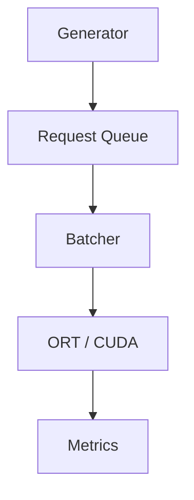

# Batching Policies for ResNet-50 GPU Inference

A C++17 inference-serving experiment that compares four request-batching policies on ResNet-50 (ONNX Runtime, CUDA) under four request workloads:

- **Static**: fixed batch size (1, 4, 8, 16)
- **Adaptive wait**: queue-based batch target with a 10 ms maximum wait
- **Adaptive immediate**: queue-based batch size, no waiting to accumulate
- **SLO-aware**: dispatch time computed from request deadlines and estimated service time

## Research question

Under which request loads does each batching policy keep tail latency inside a latency target (SLO), and what does waiting to form a batch cost? The SLO is 100 ms from arrival to completion; a run passes if at least 95% of its requests meet it.

## Why ResNet-50

The project began with a small wafer-defect CNN (about 1.5 ms per request). That model was so cheap that batching never beat batch size 1 at the loads tested, so the experiments could not show when batching helps. It was replaced by ResNet-50, whose compute cost makes batching decisions matter. The wafer-stage code, results and analysis are no longer in the working tree and remain in Git history (`07052c8`: first 84-run comparison; `857c8d8`: SLO-aware extension and its 96-run comparison).

## Pipeline

A producer thread generates requests into a thread-safe queue. The serving loop collects a batch with the selected policy, runs inference, and records request-level metrics.



This is an in-process serving simulation, not an HTTP or gRPC service. Request id `k` always carries image `(k-1) % 1000` of a fixed ImageNet subset, so every policy sees the same image and the same planned arrival for the same id.

## Experiment

Low 20 / Medium 100 / High 250 requests/s, and Bursty (250 requests/s for 500 ms, then 1500 ms off); requests are generated for 10 s and all remaining requests are then processed. SLO 100 ms, required attainment 95%, safety margin 10 ms (SLO-aware). Static 1 / 4 / 8 / 16 and Adaptive wait / Adaptive immediate / SLO-aware with max batch 16: 4 workloads x 7 policies x 3 repeats = **84 runs**, on one NVIDIA GTX 1660 SUPER (6 GB). The settings were fixed before the runs and not changed to make a policy pass. Full setup, tables and caveats: [docs/results.md](docs/results.md).

## Key results

Runs (of 3) meeting the 95% requirement:

| Policy | Low | Medium | High | Bursty |
| --- | ---: | ---: | ---: | ---: |
| Static 1 | 3 | 3 | 0 | 0 |
| Static 4 | 0 | 3 | 3 | 3 |
| Static 8 | 0 | 0 | 3 | 3 |
| Static 16 | 0 | 0 | 0 | 0 |
| Adaptive wait 16 | 3 | 3 | 3 | 3 |
| Adaptive immediate 16 | 3 | 3 | 3 | 3 |
| SLO-aware 16 | 0 | 3 | 3 | 3 |


- **Low and Medium:** immediate service is best. Static 1 and Adaptive immediate have P95 of about 23 ms (Low) and 11 ms (Medium); waiting for a batch only adds delay, and Static 4 / 8 / 16 fail at Low with mean queue waits of 75 / 176 / 369 ms.
- **High:** Static 1 is overloaded (189 req/s completed against 250 arriving, P95 about 3 s). Every policy that batches keeps up; Static 16 fails because filling 16 requests plus serving them exceeds 100 ms. **Static 4 and 8 did well**: all runs passed with lower P95 (55.6 and 61.4 ms) than the adaptive policies (80.6-89.2 ms), though fixed sizes fail at other loads.
- **Bursty:** fixed batches leave the last requests of each burst waiting for the next burst (Static 16 P95 about 1.6 s). Bursty throughput is measured from first arrival to last completion; it is not the 10 s average rate and not a capacity.
- **SLO-aware:** passed Medium, High and Bursty but failed all Low runs (63% attainment). At Low, measured service time rose far above the calibration estimate during the run and the policy had spent most of the deadline waiting. It did not beat Adaptive immediate in any workload.
- **Low service-time rise (diagnostic, Static 1 only):** in 3 extra monitored runs the service time rose from about 6 ms to about 21 ms about 5 s into the run, while the GPU's P-state (its performance / power-saving state) fell from P2 (about 1.5 GHz graphics clock) to lower-power states P3/P5 with lower clocks. This is a correlation, not an established cause; CPU effects were not excluded, and Adaptive immediate and SLO-aware were not diagnosed (section 3.7 of [docs/results.md](docs/results.md)).
- **GPU (High only, 21 separate runs):** mean sampled utilization of 70-84% across settings (whole-GPU, about 100 ms polling). Utilization shows how busy the GPU was, not which policy is more efficient; no GPU result exists for the other workloads.

No claim is made that any adaptive policy is better in all workloads. Charts: [P95 full](results/resnet50/analysis/p95_latency_full.png) / [P95 zoomed](results/resnet50/analysis/p95_latency_zoom.png), [throughput](results/resnet50/analysis/throughput.png), [queue wait](results/resnet50/analysis/queue_wait.png), [GPU utilization](results/resnet50/analysis/gpu_utilization_high.png) (SVG versions alongside).

## Model and data

The model and data are **not in Git** (`models/resnet50/`, `data/`, `.venv-resnet/` are ignored); prepare them locally:

1. Create the Python 3.12 environment `.venv-resnet` and install the pinned packages as described in [scripts/requirements-resnet.txt](scripts/requirements-resnet.txt) (CPU PyTorch, ONNX, ONNX Runtime 1.26.0, Hugging Face client).
2. Export ResNet-50 (torchvision `IMAGENET1K_V2`, FP32, dynamic batch axis) to ONNX and check it against PyTorch:
   `.venv-resnet\Scripts\python.exe scripts\prepare_resnet50.py`
3. ImageNet validation images come from the gated Hugging Face dataset `ILSVRC/imagenet-1k`. You must accept its terms on the dataset page and log in locally (`.venv-resnet\Scripts\hf.exe auth login`; the token stays in your local Hugging Face settings, never in this repository). Then select 1,000 validation images (seed 42), preprocess them with the weights' official transform and store them as a float32 file (about 602 MB; the script downloads the 14 validation files, about 6.7 GB, never the train or test split):
   `.venv-resnet\Scripts\python.exe scripts\prepare_imagenet_subset.py`
4. Verify labels, preprocessing, and PyTorch / ONNX Runtime CPU / C++ CUDA agreement on real images:
   `.venv-resnet\Scripts\python.exe scripts\verify_resnet_inputs.py`

## Build and reproduce

Requirements: Visual Studio Build Tools (C++), CMake, ONNX Runtime GPU 1.26.0, CUDA 12.6, cuDNN 9.8. Set their paths at the top of `CMakeLists.txt`, then from the repository root:

```bat
cmake -S . -B build
cmake --build build --config Release
```

Commands (any Python 3.6+ with the standard library; plotting needs matplotlib):

```bat
python scripts\profile_batches.py
python scripts\run_slo_experiments.py --max-batch 16 --repeats 3
python scripts\measure_gpu.py high static 1 --run 1 --duration 10 --slo-ms 100 --margin-ms 10 --required-percent 95 --max-wait-ms 10
python scripts\summarize_gpu.py
python scripts\plot_slo_results.py
python scripts\plot_slo_gpu.py
```

- `profile_batches.py`: per-batch service time (`results/resnet50/batch_profile/`).
- `run_slo_experiments.py`: the 84 runs (`results/resnet50/comparison/`); it refuses to start with uncommitted tracked changes or an existing output folder and records the commit and executable hash.
- `measure_gpu.py`: one GPU-monitored run (`results/resnet50/gpu/`); repeat for the 7 settings x 3 repeats of the High workload, then `summarize_gpu.py` writes `results/resnet50/gpu/summary.csv`. These runs are separate from the 84 performance runs.
- The plot scripts write `results/resnet50/analysis/` and do not overwrite existing files.

A single configuration can be run directly: `build\Release\p3_inference.exe <low|medium|high|bursty> <static|adaptive|adaptive_immediate|slo> <max_batch> <csv_path> [--duration s --slo-ms ms --margin-ms ms --required-percent p --max-wait-ms ms]`. Run from the repository root. Scheduler logic is covered by `tests/test_slo.cpp`, a dependency-free test outside the CMake build (compile it with the queue, batcher, metrics and generator sources and pass a temporary CSV path).

## Repository layout

| Path | Purpose |
| --- | --- |
| `include/`, `src/` | Request queue, generator, the four batching policies, service-time estimator, metrics, inference engine, dataset reader, model config |
| `scripts/` | Model and data preparation, verification, batch profile, experiment runner, GPU measurement and summary, plots |
| `tests/` | Scheduler, estimator and generator checks |
| `docs/results.md` | Setup, results, observations and limitations |
| `docs/slo_policy.md` | Definition of the SLO-aware policy |
| `results/resnet50/` | `comparison/` (84 runs), `gpu/` (21 monitored runs), `gpu_diagnostic/` (3 Low / Static 1 diagnostic runs with GPU state and CPU logs), `analysis/` (charts), `batch_profile/`, `pilot/` (4-run pilot, not part of the comparison) |

## Limitations

- Three repeats per setting, one machine, one GPU, one model in FP32, one SLO and margin; sample SDs of three values are rough.
- Fixed Static sizes were not tuned per workload; Static 4 / 8 doing well at High and Bursty reflects how those sizes match those rates.
- Actual arrivals deviate from the plan (generation lag averaged about 8 ms; many arrivals came in groups). Planned arrivals and images are identical across policies; actual arrivals are not. Operating-system timer granularity is a possible cause but was not tested.
- The calibration estimate underestimated service time at Low load; a diagnostic links this to GPU power states for Static 1 only, and the cause is not established (see above).
- GPU utilization was measured only at High, as whole-GPU sampling, in runs separate from the performance runs.
- Request input copying (602 KB per request) is counted in request latency; model loading, image loading and preprocessing are not.

See [docs/results.md](docs/results.md) for details.
