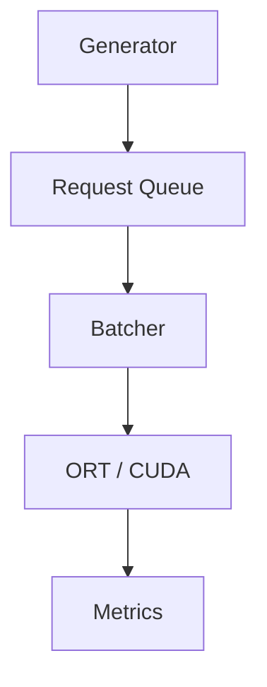

# Batching Policies for ResNet-50 GPU Inference

A C++17 inference-serving experiment that compares four request-batching policies on ResNet-50 (ONNX Runtime, CUDA) under four request workloads:

- **Static**: fixed batch size (1, 4, 8, 16)
- **Adaptive wait**: queue-based batch target with a 10 ms maximum wait
- **Adaptive immediate**: queue-based batch size, no waiting to accumulate
- **SLO-aware**: dispatch time computed from request deadlines and estimated service time

## Research question

Under which request loads does each batching policy keep tail latency inside a latency target (SLO), and what does waiting to form a batch cost? The SLO is 100 ms from arrival to completion; a run passes if at least 95% of its requests meet it.

## Why ResNet-50

The project began with a small wafer-defect CNN (about 1.5 ms per request). That model was so cheap that batching never beat batch size 1 at the loads tested, so the experiments could not show when batching helps. It was replaced by ResNet-50, whose compute cost makes batching decisions matter. The wafer-stage code, results and analysis are no longer in the working tree and remain in Git history (`07052c8`: first 84-run comparison; `857c8d8`: SLO-aware extension and its 96-run comparison).

## Pipeline

A producer thread generates requests into a thread-safe queue. The serving loop collects a batch with the selected policy, runs inference, and records request-level metrics.



This is an in-process serving simulation, not an HTTP or gRPC service. Request id `k` always carries image `(k-1) % 1000` of a fixed ImageNet subset, so every policy sees the same image and the same planned arrival for the same id.

## Experiment

Low 20 / Medium 100 / High 250 requests/s, and Bursty (250 requests/s for 500 ms, then 1500 ms off); requests are generated for 10 s and all remaining requests are then processed. SLO 100 ms, required attainment 95%, safety margin 10 ms (SLO-aware). Static 1 / 4 / 8 / 16 and Adaptive wait / Adaptive immediate / SLO-aware with max batch 16: 4 workloads x 7 policies x 3 repeats = **84 runs**, on one NVIDIA GTX 1660 SUPER (6 GB). The settings were fixed before the runs and not changed to make a policy pass. Full setup, tables and caveats: [docs/results.md](docs/results.md).

## Key results

Runs (of 3) meeting the 95% requirement:

| Policy | Low | Medium | High | Bursty |
| --- | ---: | ---: | ---: | ---: |
| Static 1 | 3 | 3 | 0 | 0 |
| Static 4 | 0 | 3 | 3 | 3 |
| Static 8 | 0 | 0 | 3 | 3 |
| Static 16 | 0 | 0 | 0 | 0 |
| Adaptive wait 16 | 3 | 3 | 3 | 3 |
| Adaptive immediate 16 | 3 | 3 | 3 | 3 |
| SLO-aware 16 | 0 | 3 | 3 | 3 |


- **Low and Medium:** Static 1 and Adaptive immediate had the lowest mean P95 latency (about 23 ms at Low and 11 ms at Medium). Waiting for a batch added delay: Static 4 / 8 / 16 failed at Low with mean queue waits of 75 / 176 / 369 ms.
- **High:** Static 1 was overloaded (189 req/s completed while 250 arrived, P95 about 3 s). The batching settings completed about 248-249 req/s; Static 16 still failed because filling 16 requests plus serving them exceeds 100 ms. **Static 4 and 8 did well**: all runs passed with lower P95 (55.6 and 61.4 ms) than the adaptive policies (80.6-89.2 ms), though fixed sizes fail at other loads.
- **Bursty:** fixed batches leave the last requests of each burst waiting for the next burst (Static 16 P95 about 1.6 s). Bursty throughput is measured from first arrival to last completion; it is not the 10 s average rate and not a capacity.
- **SLO-aware:** passed Medium, High and Bursty but failed all Low runs (63% attainment). At Low, measured service time rose far above the calibration estimate during the run and the policy had spent most of the deadline waiting. It did not beat Adaptive immediate in any workload.
- **Low service-time rise (diagnostic, Static 1 only):** in 3 extra monitored runs the service time rose from about 6 ms to about 21 ms about 5 s into the run, while the GPU's P-state (its performance / power-saving state) fell from P2 (about 1.5 GHz graphics clock) to lower-power states P3/P5 with lower clocks. This is a correlation, not an established cause; CPU effects were not excluded, and Adaptive immediate and SLO-aware were not diagnosed (section 3.7 of [docs/results.md](docs/results.md)).
- **GPU (High only, 21 separate runs):** mean sampled utilization of 70-84% across settings (whole-GPU, about 100 ms polling). Utilization shows how busy the GPU was, not which policy is more efficient; no GPU result exists for the other workloads.

No claim is made that any adaptive policy is better in all workloads. Charts: [P95 full](results/resnet50/analysis/p95_latency_full.png) / [P95 zoomed](results/resnet50/analysis/p95_latency_zoom.png), [throughput](results/resnet50/analysis/throughput.png), [queue wait](results/resnet50/analysis/queue_wait.png), [GPU utilization](results/resnet50/analysis/gpu_utilization_high.png) (SVG versions alongside).

## Setup

The model and data are **not in Git** (`models/resnet50/`, `data/` and `.venv-resnet/` are ignored), so a clone has to prepare them. Run the commands from the repository root in **Windows PowerShell**. The order matters: Python environment → model and data → C++ build → real-image verification (the verification script runs the C++ executable).

### 1. Python environment

Python 3.12 environment `.venv-resnet` with the pinned versions of [scripts/requirements-resnet.txt](scripts/requirements-resnet.txt) (CPU PyTorch, ONNX, ONNX Runtime 1.26.0, Hugging Face client); the file lists the exact install commands in order:

```powershell
py -3.12 -m venv .venv-resnet
.venv-resnet\Scripts\python.exe -m pip install torchvision==0.29.2 --index-url https://download.pytorch.org/whl/cpu
.venv-resnet\Scripts\python.exe -m pip install onnx==1.23.2 onnxscript==0.7.2 onnxruntime==1.26.0
.venv-resnet\Scripts\python.exe -m pip install datasets==5.1.0
```

### 2. Model and data

```powershell
.venv-resnet\Scripts\python.exe scripts\prepare_resnet50.py
.venv-resnet\Scripts\hf.exe auth login
.venv-resnet\Scripts\python.exe scripts\prepare_imagenet_subset.py --plan
.venv-resnet\Scripts\python.exe scripts\prepare_imagenet_subset.py
```

- `prepare_resnet50.py` exports ResNet-50 (torchvision `IMAGENET1K_V2`, FP32, dynamic batch axis) to `models/resnet50/` and checks it against PyTorch.
- ImageNet validation images come from the gated Hugging Face dataset `ILSVRC/imagenet-1k`: accept its terms on the dataset page and log in locally (`hf auth login`; the token stays in your local Hugging Face settings, never in this repository).
- `prepare_imagenet_subset.py --plan` only prints the selection and download size. Without `--plan` it selects 1,000 validation images (seed 42), preprocesses them with the weights' official transform and writes a float32 file of about 602 MB to `data/imagenet/`. It downloads the 14 validation files (about 6.7 GB), never train or test, into `data/imagenet/hf_cache/`; keep that cache until the verification step is done.

### 3. C++ build

Requirements: Visual Studio Build Tools (C++), CMake, ONNX Runtime GPU 1.26.0, CUDA 12.6, cuDNN 9.8. Set their paths at the top of `CMakeLists.txt`, then:

```powershell
cmake -S . -B build
cmake --build build --config Release
```

### 4. Real-image verification

```powershell
.venv-resnet\Scripts\python.exe scripts\verify_resnet_inputs.py
```

`verify_resnet_inputs.py` checks the subset file, the label mapping, the preprocessing, and that PyTorch, ONNX Runtime CPU and the C++ CUDA executable (`build\Release\p3_inference.exe`, `model_check` mode) give matching outputs on real images. It reuses the cached files in `data/imagenet/hf_cache/`; if the dataset's small `classes.py` (the synset list) is missing it downloads that one file from the same dataset revision into the same cache (this needs the Hugging Face login of step 2), and it prints instructions if that fails. It never downloads the validation files.

## Reproduce and re-run

The published results in `results/resnet50/` are kept. Every command below writes to a **new** path and refuses to overwrite existing results. All of them need only Python 3.6+ with the standard library, except the two plotting scripts (matplotlib).

| Step | Command | Notes |
| --- | --- | --- |
| Batch profile | `python scripts\profile_batches.py --output results\resnet50\batch_profile_rerun` | one process per batch size |
| 84 runs | `python scripts\run_slo_experiments.py --max-batch 16 --repeats 3 --output results\resnet50\comparison_rerun` | add `--dry-run` to preview the 84 jobs; about 30-40 min; requires no uncommitted changes to tracked files (or `--allow-dirty`) and an executable newer than the sources; records the commit and executable hash |
| One GPU-monitored run | `python scripts\measure_gpu.py high static 1 --run 1 --duration 10 --slo-ms 100 --margin-ms 10 --required-percent 95 --max-wait-ms 10 --output-root results\resnet50\gpu_rerun` | repeat for the 7 settings (static 1 / 4 / 8 / 16, adaptive 16, adaptive_immediate 16, slo 16) x 3 `--run` numbers; separate from the 84 runs |
| Charts | `python scripts\plot_slo_results.py --output results\resnet50\analysis_regenerated` and `python scripts\plot_slo_gpu.py --output results\resnet50\analysis_regenerated` | see below |
| GPU summary | `python scripts\summarize_gpu.py --output results\resnet50\gpu_summary_check.csv` | see below |

What the analysis scripts read:

- **`plot_slo_results.py` always reads the published `results/resnet50/comparison/`** (the path is fixed in the script and there is no option to change it). It does not read the output of a new run such as `comparison_rerun`. Only `--output` can be set; it must be a folder where the chart files do not exist yet.
- **`plot_slo_gpu.py`** reads `results/resnet50/gpu/summary.csv` by default; `--input` can point to another summary file of the same format. `--output` must not already contain its chart files.
- **`summarize_gpu.py`** checks and summarizes the published `results/resnet50/gpu/` runs together with the published `comparison/experiment_config.json`. `--output` only sets the summary file; it cannot read `gpu_rerun`. It also requires the current `build\Release\p3_inference.exe` to have the same SHA-256 as the executable recorded in the published runs; a newly built executable differs, so after a fresh build it reports the mismatch and writes nothing (the published `summary.csv` is already in the repository).

A single configuration can be run directly: `build\Release\p3_inference.exe <low|medium|high|bursty> <static|adaptive|adaptive_immediate|slo> <max_batch> <csv_path> [--duration s --slo-ms ms --margin-ms ms --required-percent p --max-wait-ms ms]`.

### Scheduler tests

`tests/test_slo.cpp` is a dependency-free test of the queue, batchers, estimator, generator and metrics (it needs no ONNX Runtime, CUDA or model, and is not part of the CMake build). It needs five sources besides itself and takes one argument, a path for a temporary CSV file.

With Visual Studio's compiler, in the **"x64 Native Tools Command Prompt for VS"** (or any command prompt where `vcvars64.bat` has been run), from the repository root:

```bat
mkdir build\tests
cl /nologo /std:c++17 /EHsc /O2 /Iinclude tests\test_slo.cpp src\slo_batcher.cpp src\static_batcher.cpp src\adaptive_batcher.cpp src\metrics.cpp src\request_generator.cpp /Fo:build\tests\ /Fe:build\tests\test_slo.exe
build\tests\test_slo.exe build\tests\test_metrics.csv
```

With MinGW-w64 / MSYS2 `g++` in a Bash shell (such as Git Bash), from the repository root; `-static` avoids missing runtime DLLs:

```bash
mkdir -p build/tests
g++ -std=c++17 -static -pthread -Iinclude tests/test_slo.cpp src/slo_batcher.cpp src/static_batcher.cpp src/adaptive_batcher.cpp src/metrics.cpp src/request_generator.cpp -o build/tests/test_slo.exe
build/tests/test_slo.exe build/tests/test_metrics.csv
```

A passing run prints `Scheduler, baseline, estimator, and metrics checks passed.`; the test takes a few seconds.

## Repository layout

| Path | Purpose |
| --- | --- |
| `include/`, `src/` | Request queue, generator, the four batching policies, service-time estimator, metrics, inference engine, dataset reader, model config |
| `scripts/` | Model and data preparation, verification, batch profile, experiment runner, GPU measurement and summary, plots |
| `tests/` | Scheduler, estimator and generator checks |
| `docs/results.md` | Setup, results, observations and limitations |
| `docs/slo_policy.md` | Definition of the SLO-aware policy |
| `results/resnet50/` | `comparison/` (84 runs), `gpu/` (21 monitored runs), `gpu_diagnostic/` (3 Low / Static 1 diagnostic runs with GPU state and CPU logs), `analysis/` (charts), `batch_profile/`, `pilot/` (4-run pilot, not part of the comparison) |

## Limitations

- Three repeats per setting, one machine, one GPU, one model in FP32, one SLO and margin; sample SDs of three values are rough.
- Fixed Static sizes were not tuned per workload; Static 4 / 8 doing well at High and Bursty reflects how those sizes match those rates.
- Actual arrivals deviate from the plan (generation lag averaged about 8 ms; many arrivals came in groups). Planned arrivals and images are identical across policies; actual arrivals are not. Operating-system timer granularity is a possible cause but was not tested.
- The calibration estimate underestimated service time at Low load; a diagnostic links this to GPU power states for Static 1 only, and the cause is not established (see above).
- GPU utilization was measured only at High, as whole-GPU sampling, in runs separate from the performance runs.
- Request input copying (602 KB per request) is counted in request latency; model loading, image loading and preprocessing are not.

See [docs/results.md](docs/results.md) for details.
