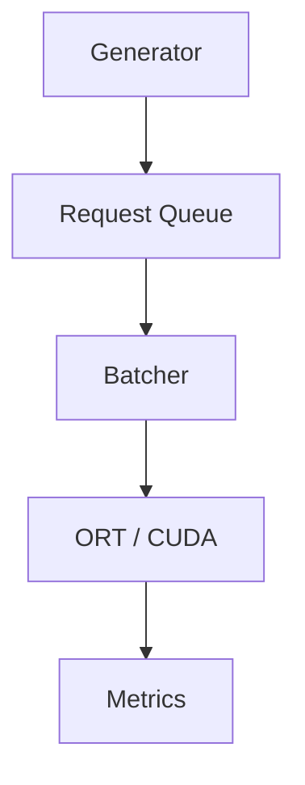

# Batching Policies for ResNet-50 GPU Inference

A C++17 inference-serving experiment that compares four request-batching policies on ResNet-50 with ONNX Runtime and CUDA:

- **Static**: fixed batch size
- **Adaptive wait**: queue-based batch target with a maximum wait
- **Adaptive immediate**: queue-based batch size without waiting to accumulate
- **SLO-aware**: dispatch time computed from request deadlines and estimated service time

**Status:** the ResNet-50 model, a fixed 1,000-image ImageNet validation subset, and a per-batch service-time profile are done. **The formal policy comparison has not started.** Request rates, maximum batch size, the SLO, and the safety margin are not decided yet; they will be chosen after looking at the batch profile. The serving loop is disabled until the image pool is connected to the request generator (`p3_inference` exits with a message when asked to serve).

## Background

The project started with a small wafer-defect CNN. That model is so cheap (about 1.5 ms per request) that batching never beat batch size 1 at the tested loads, so the experiments could not show when batching helps. It was replaced with ResNet-50, whose compute cost makes batching decisions matter. The wafer code, results, and analysis are not kept in the working tree; they remain in Git history (last wafer-era commits: `07052c8` for the first 84-run comparison, `857c8d8` for the SLO-aware extension and its 96-run comparison).

## Pipeline

A producer thread generates requests into a thread-safe queue. The serving loop collects a batch with the selected policy, runs inference, and records request-level metrics.



This is an in-process serving simulation, not an HTTP or gRPC service.

## Model and Data

| Item | Value |
| --- | --- |
| Model | torchvision ResNet-50, `IMAGENET1K_V2` weights, FP32 |
| ONNX | `models/resnet50/resnet50_v2_fp32.onnx` (+ `.onnx.data`), dynamic batch axis, input `[N,3,224,224]`, output `[N,1000]` |
| Data | 1,000 ImageNet validation images (Hugging Face `ILSVRC/imagenet-1k`, revision pinned), chosen with seed 42, preprocessed with the official V2 transform |
| Prepared file | `data/imagenet/val1000_resnet50_v2_nchw_f32.bin`, float32 little-endian, 602,112,000 bytes |

The model and data files are not in Git. ImageNet requires accepting its terms on Hugging Face and logging in locally.

Verification (4 real images, batch 1 and 4): PyTorch CPU, ONNX Runtime CPU, and the C++ ONNX Runtime CUDA path agree to a maximum absolute difference below 1e-5 (`allclose` with rtol 1e-3, atol 1e-4, same top-1). Labels were checked against the dataset's synset list, and the stored tensors equal the official transform output (`scripts/verify_resnet_inputs.py`).

## Batch Profile

Sequential back-to-back batches of the first N prepared images (no arriving traffic), 3 warm-up runs, then 10 timed runs per size, one process per size. Service time covers batch assembly, tensor setup, and `session.Run`. Details and raw timings are in `results/resnet50/batch_profile/`.

| Batch | Mean | Median | P95* | Observed sequential rate | Sampled GPU memory |
| ---: | ---: | ---: | ---: | ---: | ---: |
| 1 | 6.20 ms | 6.18 ms | 6.38 ms | 161 img/s | 344 MiB |
| 4 | 17.08 ms | 16.87 ms | 18.26 ms | 234 img/s | 342 MiB |
| 8 | 29.25 ms | 29.12 ms | 30.03 ms | 273 img/s | 598 MiB |
| 16 | 52.42 ms | 51.85 ms | 54.66 ms | 305 img/s | 600 MiB |
| 32 | 97.03 ms | 97.04 ms | 99.89 ms | 330 img/s | 1112 MiB |

\*P95 of 10 runs is interpolated near the maximum. The rate is batch size divided by mean service time; it is not the throughput of a serving run with arriving requests. Memory is whole-GPU `nvidia-smi` memory sampled about every 100 ms, so it is a sampled value, not an exact peak. One measurement session on a GTX 1660 SUPER (6 GB); no repeats.

## Environment

| Component | Configuration |
| --- | --- |
| GPU | NVIDIA GeForce GTX 1660 SUPER, 6 GB (Windows, WDDM) |
| Build | C++17, MSVC (Visual Studio Build Tools), CMake |
| Inference runtime | ONNX Runtime GPU 1.26.0, CUDA 12.6, cuDNN 9.8 |
| Python (data/model preparation) | 3.12 environment `.venv-resnet`, versions in `scripts/requirements-resnet.txt` |

## Build and Run

Update the dependency paths at the top of `CMakeLists.txt`, then from the repository root:

```bat
cmake -S . -B build
cmake --build build --config Release
```

Prepare the model and data once (see `scripts/requirements-resnet.txt` for the environment):

```bat
.venv-resnet\Scripts\python.exe scripts\prepare_resnet50.py
.venv-resnet\Scripts\hf.exe auth login
.venv-resnet\Scripts\python.exe scripts\prepare_imagenet_subset.py
.venv-resnet\Scripts\python.exe scripts\verify_resnet_inputs.py
```

Measure the batch profile (runs `batch_profile` once per batch size):

```bat
python scripts\profile_batches.py
```

Command line:

```text
p3_inference.exe <workload> <static|adaptive|adaptive_immediate|slo> <batch_size> <csv_path>
p3_inference.exe <any> model_check <1|4> <logits_path>
p3_inference.exe <any> batch_profile <1|4|8|16|32> <csv_path>
```

Run from the repository root so relative paths resolve. Serving modes exit with a message until the image pool is connected. Scheduler logic is covered by `tests/test_slo.cpp`, a dependency-free test that is not part of the CMake build; compile it with the queue, batcher, metrics, and generator sources and pass a temporary CSV path as its argument.

## Repository Layout

| Path | Purpose |
| --- | --- |
| `include/`, `src/` | Request queue, generator, Static/Adaptive/SLO batchers, service-time estimator, metrics, inference engine, dataset reader, model config |
| `scripts/prepare_resnet50.py`, `prepare_imagenet_subset.py`, `verify_resnet_inputs.py` | Model export, data preparation, and input verification |
| `scripts/profile_batches.py` | Per-batch service-time profile |
| `scripts/run_slo_experiments.py`, `measure_gpu.py`, `plot_slo_*.py`, `check_slo.py`, `check_metrics.py` | Policy comparison, GPU monitoring, plots, and CSV checks. Reused from the wafer stage and **not yet adapted**: they still assume the old workloads and a 20 ms SLO with a 10 ms margin, to be re-parameterized once the ResNet-50 settings are chosen |
| `docs/slo_policy.md` | SLO-aware policy definition and margin history |
| `results/resnet50/` | ResNet-50 measurements |
| `models/`, `data/` | Model and dataset files (ignored by Git) |

## Next Steps

- Connect the fixed image pool, with one shared order and arrival schedule, to the request generator.
- Choose request rates, maximum batch size, SLO, and safety margin from the batch profile.
- Run the Static / Adaptive wait / Adaptive immediate / SLO-aware comparison with repeats and GPU monitoring.

## Completion Status

- [x] Request generator, thread-safe queue, and four batching policies
- [x] Request-level timing metrics and SLO accounting
- [x] ResNet-50 ONNX export and real-image input verification (PyTorch / ORT CPU / C++ CUDA)
- [x] Fixed 1,000-image ImageNet validation subset
- [x] Per-batch service-time profile (single session)
- [ ] Image pool connected to the generator
- [ ] Workloads, maximum batch size, and SLO chosen for ResNet-50
- [ ] ResNet-50 policy comparison (not started)
