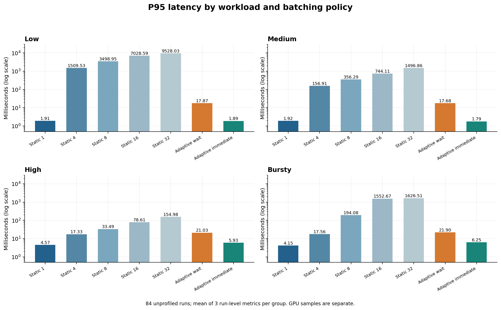
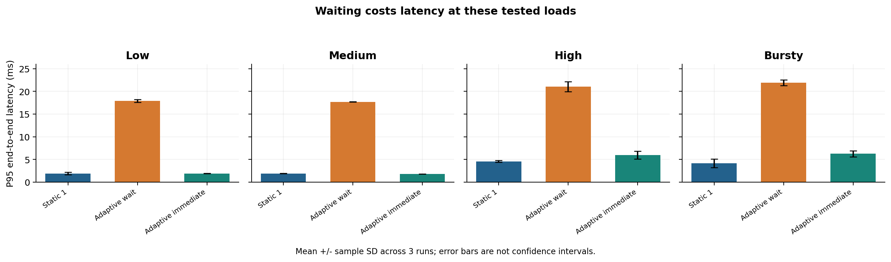
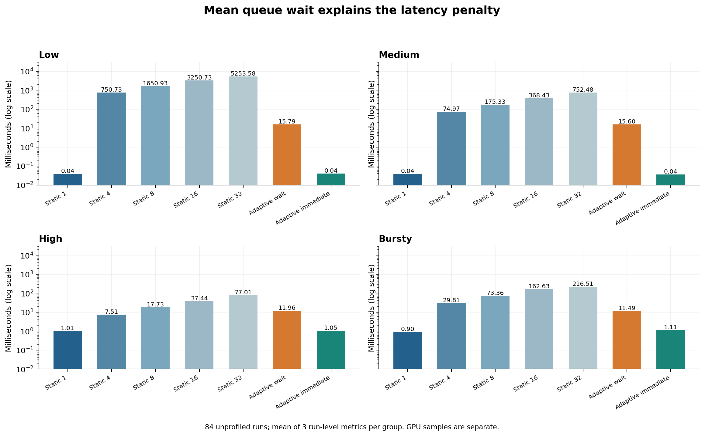
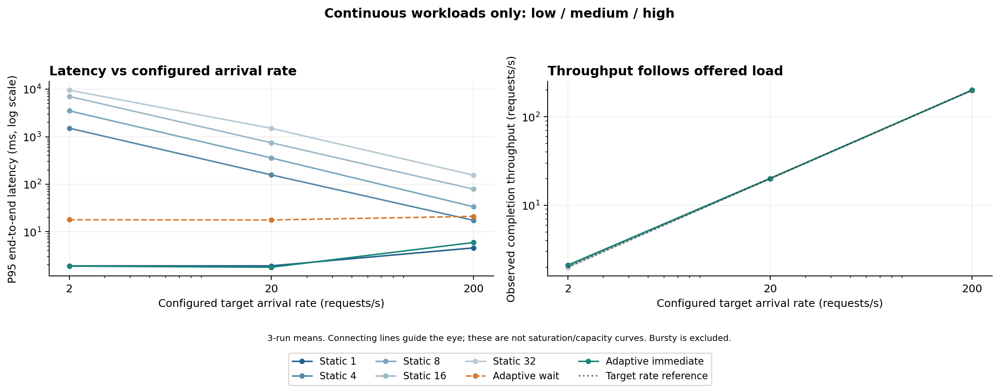
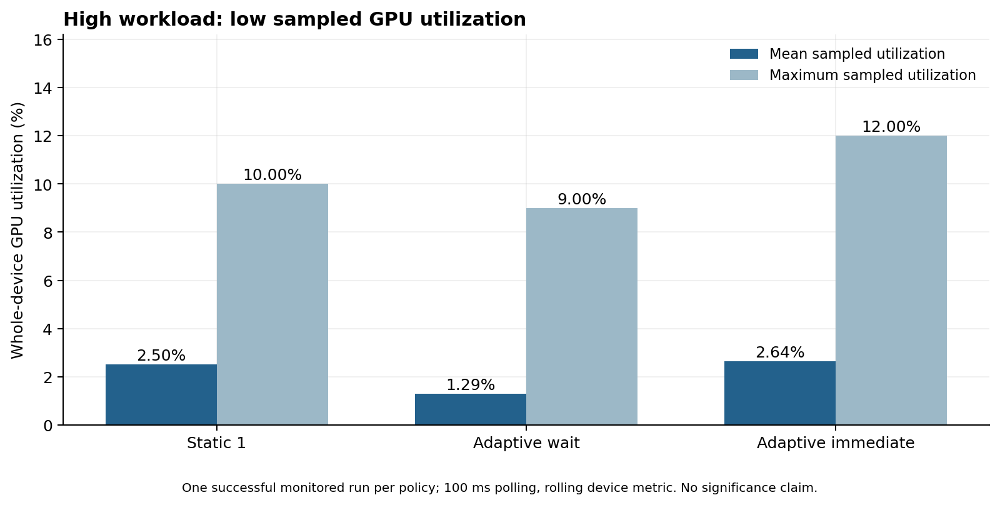
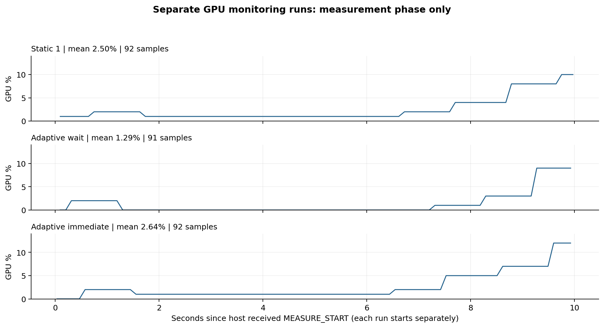

# Batching experiments: results and limitations

For this small wafer CNN and the tested arrival rates, accumulating a batch often added more latency than it saved. Queue-aware immediate dispatch avoided most of that waiting, but did not consistently improve on Static batch 1. Adaptive waiting substantially reduced latency relative to large fixed batches, without demonstrating a processing-capacity advantage in this experiment.

## Experiment scope

- GPU: NVIDIA GeForce GTX 1660 SUPER, 6 GB; Windows WDDM.
- Inference: C++17, ONNX Runtime GPU 1.26.0, CUDA 12.6, FP32, grayscale input `[N, 1, 24, 24]`.
- Static: fixed batch sizes 1, 4, 8, 16, 32, waiting for a full batch or generator closure.
- Adaptive wait: queue-size-based target, initially at most 4 and increased up to the configured maximum of 32; dispatch on target size, oldest-arrival timeout (configured 10 ms), or queue closure.
- Adaptive immediate: select a supported batch size from queued requests, up to 32, with no intentional accumulation wait. It may use batch 1 on short queues.
- Workloads: low 2 requests/s, medium 20 requests/s, high 200 requests/s; bursty 200 requests/s during 500 ms on / 1500 ms off. Each generator runs for 10 seconds.
- All batch sizes 1 through 32 are warmed up three times before measured requests.
- Benchmark: 4 workloads x 7 policies x 3 repeats = 84 runs. Immediate-policy runs were collected separately from the original 72-run session; comparisons are not temporally paired.

## Latency and queue wait



The panels share a **logarithmic vertical scale**. Each number is the mean of three independently calculated run-level P95 values; it is not the P95 of pooled requests.

| Workload | Static 1 P95 (ms) | Adaptive wait P95 (ms) | Adaptive immediate P95 (ms) |
| --- | ---: | ---: | ---: |
| Low | 1.912 | 17.871 | 1.890 |
| Medium | 1.915 | 17.677 | 1.790 |
| High | 4.569 | 21.031 | 5.933 |
| Bursty | 4.152 | 21.898 | 6.250 |



Error bars are sample standard deviations across three runs, not confidence intervals. Small differences on low and medium do not establish statistically reliable superiority.



At low load, Adaptive wait spends about 15.788 ms in queue on average, versus 0.039 ms for Static 1 and 0.040 ms for Adaptive immediate. Waiting therefore dominates the added latency. A 10 ms configured timeout is not a hard end-to-end latency bound: thread scheduling, wake-up delays, and server work can delay dispatch.

Large fixed batches are particularly costly with sparse requests. Static 32 has a low-workload P95 of 9528.027 ms because only 20 requests arrive, fewer than one full batch; the pending batch is released when the generator closes. Adaptive wait has a P95 of 17.871 ms in the same workload, but this compares both batch-selection policy and timeout behavior, not queue-size adaptation alone.

Bursty traffic can leave a partial static batch waiting through an off period. Static 4 has a mean run-level P99 of 1015.255 ms despite a P95 of 17.556 ms. Static 8 P95 is variable: mean 194.084 ms, SD 255.138 ms (CV 131.46%). This is a tail-sensitive workload; averages alone hide large differences among runs. Adaptive wait and Adaptive immediate have mean run-level P99 values of 25.559 and 8.566 ms, respectively, while Static 1 is 5.370 ms.

## Arrival rate, latency, and throughput



Only continuous low / medium / high workloads appear on these curves. Bursty has the same active-phase target as high but a different duty cycle, so it is not a comparable constant 200 requests/s point. Connecting lines are visual guides between the three tested settings.

At high load, Static 1, Adaptive wait, and Adaptive immediate achieve approximately 199.945, 199.684, and 199.969 requests/s. These values track the offered load. The measurements do **not** demonstrate maximum throughput or a batching-related capacity improvement.

The implementation defines throughput as completed requests divided by the interval from first actual arrival to last completion. That interval is not always the configured 10-second generator duration. Low results around 2.10 requests/s and bursty results around 49–58 requests/s must be interpreted using that denominator. In particular, bursty differences can include whether completion extends into the final off period; they are not evidence of an equivalent increase in GPU capacity. A fully realized bursty schedule would offer about 500 requests over the complete 10-second window (50 requests/s on average).

## Separate GPU measurements



| Policy | Mean sampled GPU utilization | Max sampled GPU utilization | Valid samples | Completed requests |
| --- | ---: | ---: | ---: | ---: |
| Static 1 | 2.50% | 10% | 92 | 1998 |
| Adaptive wait | 1.29% | 9% | 91 | 1998 |
| Adaptive immediate | 2.64% | 12% | 92 | 1998 |

Each row is **one successful separate monitored high-workload run**, not an average over the 84 benchmark runs. The incomplete `high_adaptive_immediate_b32_run1` directory has no completed measurement and is excluded. The successful immediate run is run 2. No GPU utilization measurements exist here for the other workloads or static batch sizes 4–32.



The monitor polls `nvidia-smi` every 100 ms and selects samples labeled `measurement`, using host receipt of the start/end markers. The utilization metric describes the whole GPU and has its own rolling measurement window; polling every 100 ms does not make samples independent or define 100 ms kernel-level resolution. Sample counts are not repeated experimental trials. Initialization and warm-up samples are excluded, although rolling-window effects and marker receipt timing limit boundary precision. Mean utilization is the arithmetic sample mean.

The small differences between policies are descriptive. One monitored run per policy does not establish a reliable utilization ranking. The measurements are consistent with low GPU activity at the tested load, rather than sustained saturation.

In the monitored immediate run, 1778 requests were processed in batches of 1 and 220 in batches of 4. That corresponds to 1778 singleton batches and 55 four-request batches: most dispatches were still singletons. These counts describe this monitored run only.

## Nsight observation

The supplied Nsight Systems view shows CUDA kernel activity separated by visible gaps. One selected cuDNN convolution kernel took **13.216 microseconds** on Stream 29. This is one kernel duration, not complete model inference latency. Its theoretical occupancy of 100% is not 100% time-averaged GPU utilization.

The application's `RequestQueue` wait was not explicitly annotated on the timeline. Kernel gaps therefore cannot be attributed entirely to application queue wait, CPU processing, or any single bottleneck. Console start/end markers do not create NVTX ranges. The Nsight run is separate from both the unprofiled benchmark and the GPU monitor runs, and its request CSV is excluded from those results.

## What the results support

- **Useful relative to large fixed batches:** both adaptive variants avoid seconds of batch-formation delay in sparse traffic. A timeout limits intentional accumulation, and immediate dispatch avoids that accumulation altogether.
- **Costly under the tested light workloads:** Adaptive wait adds queue delay without an observed throughput benefit. Its initial target can request multiple items even when only one is queued.
- **Immediate dispatch is a useful low-wait baseline:** it approaches Static 1 on low and medium, but Static 1 has lower mean P95 and P99 on high and bursty in these measurements.
- **A favorable regime versus Static 1 has not been demonstrated:** higher load, larger models, or more GPU work per request might change the trade-off, but those are future experiments, not findings from these data.

## Measurement limitations

1. Only three benchmark repeats per setting and 20 low-workload requests per run; extreme percentiles have little supporting data. Aggregates here are run-level means, not pooled percentiles.
2. Immediate experiments were run in a separate session. Environmental differences can affect small policy differences.
3. Windows scheduling causes generation lag and request bunching. Absolute arrival scheduling improves long-run rate agreement but does not ensure evenly spaced arrivals.
4. Static has no timeout while Adaptive wait does; these policies differ along multiple dimensions.
5. Service time includes batch-input assembly, tensor setup, transfers/overhead inside `session.Run`, and inference. It is not isolated GPU kernel time. Image preprocessing is performed once before request generation and is outside these serving latencies.
6. Per-request CSV writing after service completion can affect later dispatch timing. The producer also copies a preprocessed input into each request before enqueueing.
7. This is a local in-process serving simulation using the same input repeatedly, not an HTTP/gRPC deployment or a broad input-distribution evaluation.
8. GPU samples are whole-device, coarse-grained, single-run observations for high only. A precise CPU or transfer bottleneck has not been established.

## Reproduce the figures

From the repository root:

```bat
python -m pip install matplotlib numpy
python scripts\plot_results.py
```

The script reads the original `results/combined/comparison.csv` when present. This deliverable also includes `results/analysis/comparison_input.csv`, a 28-row subset of the supplied aggregate columns used to reproduce the figures when the original is absent. Chat formatting markers and HTML entities are not data. Full original raw benchmark CSVs are not duplicated in this package; they remain in the existing repository. GPU metadata and measurement samples come from the uploaded `gpu.zip`.

Figures are saved as PNG and SVG in `results/analysis/`; `gpu_summary.csv` is computed only from successful GPU-monitor runs. This command draws figures without rerunning inference. A preexisting equivalent plot script should be reviewed before replacing it. Existing project files, result CSVs, and README do not need to be overwritten.
