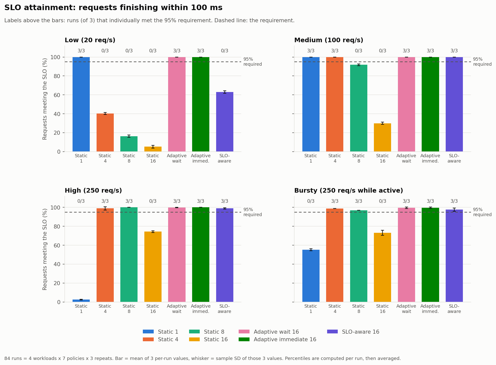
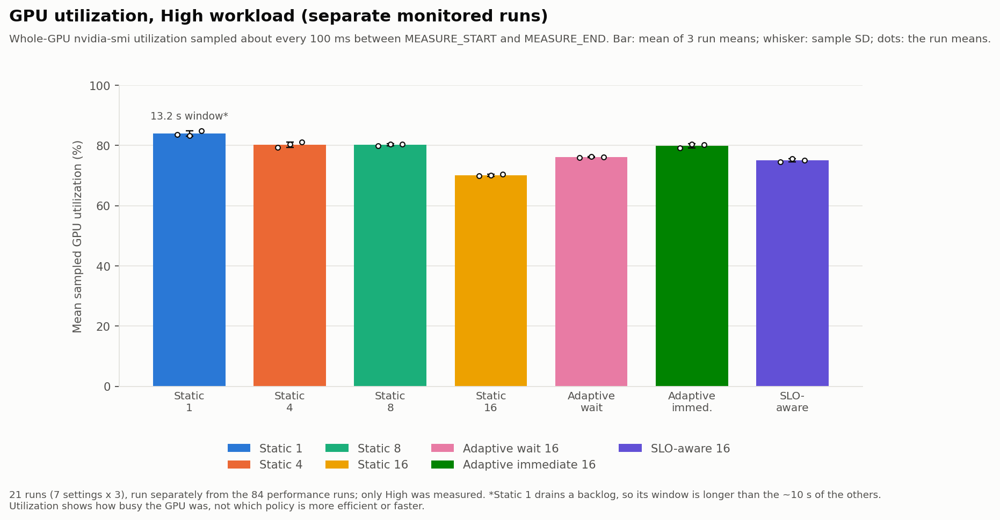

# ResNet-50 batching policy comparison: results

This document describes one experiment: four batching policies (Static, Adaptive wait, Adaptive immediate, SLO-aware) serving ResNet-50 on one GPU under four request workloads. Everything below comes from `results/resnet50/comparison/` (84 performance runs) and `results/resnet50/gpu/` (21 separate GPU-monitored runs). The numbers in the tables are copied from `summary.csv` / `comparison.csv` / the GPU `summary.csv`.

## 1. Setup

| Item | Value |
| --- | --- |
| Model | torchvision ResNet-50 `IMAGENET1K_V2`, FP32, ONNX Runtime 1.26.0 with the CUDA execution provider |
| Hardware | NVIDIA GeForce GTX 1660 SUPER (6 GB), Windows (WDDM) |
| Inputs | 1,000 fixed ImageNet validation images preprocessed once and held in RAM; request id `k` carries image `(k-1) % 1000`, so every policy sees the same image for the same id |
| Workloads | Low 20 req/s, Medium 100 req/s, High 250 req/s, Bursty 250 req/s while active (500 ms on, 1500 ms off) |
| Duration | requests are generated for 10 s, then every remaining request is processed |
| SLO | 100 ms from actual arrival to completion; a run **passes** if at least 95% of its requests meet it |
| Safety margin (SLO-aware) | 10 ms |
| Policies | Static batch 1 / 4 / 8 / 16; Adaptive wait (max wait 10 ms, max batch 16); Adaptive immediate (max batch 16); SLO-aware (max batch 16) |
| Repeats | 3 per setting: 4 workloads x 7 policies x 3 = **84 runs**, order shuffled within each repeat (seed 42) |
| Calibration | before each run, 3 warm-up + 10 timed batches for every batch size from 1 to the run's max batch; the estimate is the prefix maximum of the per-size maxima. The same method is used for every policy |
| Code | commit `79dc7e8`, executable SHA-256 `37dbddf03b41cb41…` |

The settings were fixed before the runs and were not changed to make a policy pass. The SLO and margin were chosen from the batch profile and a 4-run pilot (`results/resnet50/batch_profile/`, `results/resnet50/pilot/`), not from the final results.

## 2. How to read the numbers

- **Per-run first.** P50/P95/P99, SLO attainment, throughput and queue wait are computed inside each run. Tables and charts show the **mean of the 3 per-run values** and their **sample standard deviation** (n = 3, so the SD is only a rough indication). Requests of different runs are never pooled and percentiles are never recomputed from pooled requests.
- **Throughput** is completed requests divided by (last completion - first actual arrival). It is an observed rate for that run, not a maximum capacity.
- **Queue wait** is arrival to the start of service. **Mean batch** is requests divided by dispatched batches.
- **Runs meeting** is how many of the 3 runs individually reached 95% attainment; the mean attainment alone can hide a failing run.
- **Generation lag** is actual minus planned arrival. Actual arrivals are *not* identical between runs; the planned arrival of each request id and its image are (checked for every run).

## 3. Results

Charts: [SLO attainment](../results/resnet50/analysis/slo_attainment.png), [P95 full range](../results/resnet50/analysis/p95_latency_full.png), [P95 zoomed](../results/resnet50/analysis/p95_latency_zoom.png), [throughput](../results/resnet50/analysis/throughput.png), [mean queue wait](../results/resnet50/analysis/queue_wait.png). Vector versions (`.svg`) are in the same folder.



### 3.1 Overview: runs meeting the 95% requirement (of 3)

| Policy | Low | Medium | High | Bursty | All (of 12) |
| --- | ---: | ---: | ---: | ---: | ---: |
| Static 1 | 3/3 | 3/3 | 0/3 | 0/3 | **6** |
| Static 4 | 0/3 | 3/3 | 3/3 | 3/3 | **9** |
| Static 8 | 0/3 | 0/3 | 3/3 | 3/3 | **6** |
| Static 16 | 0/3 | 0/3 | 0/3 | 0/3 | **0** |
| Adaptive wait 16 | 3/3 | 3/3 | 3/3 | 3/3 | **12** |
| Adaptive immediate 16 | 3/3 | 3/3 | 3/3 | 3/3 | **12** |
| SLO-aware 16 | 0/3 | 3/3 | 3/3 | 3/3 | **9** |

Only Adaptive wait and Adaptive immediate met the requirement in every one of their 12 runs. That is a statement about these four workloads and this SLO, not a ranking: the policies that meet the requirement still differ in latency (see the tables below), and Static 4 and Static 8 have lower P95 than the adaptive policies at High and Bursty load.

### 3.2 Low (20 req/s): immediate service is enough

| Policy | SLO attainment % (mean ± SD) | Runs meeting | P50 ms | P95 ms (± SD) | P99 ms | Throughput req/s | Mean queue wait ms | Mean batch |
| --- | ---: | ---: | ---: | ---: | ---: | ---: | ---: | ---: |
| Static 1 | 100.0 ± 0.0 | 3/3 | 8.4 | 22.6 ± 0.3 | 23.2 | 20.0 | 0.3 | 1.00 |
| Static 4 | 40.3 ± 1.0 | 0/3 | 119.9 | 222.9 ± 3.7 | 235.8 | 19.9 | 75.1 | 4.00 |
| Static 8 | 16.3 ± 1.3 | 0/3 | 237.6 | 429.1 ± 9.6 | 472.9 | 19.9 | 175.5 | 8.00 |
| Static 16 | 5.2 ± 1.5 | 0/3 | 458.3 | 829.3 ± 24.5 | 903.8 | 19.9 | 369.0 | 15.38 |
| Adaptive wait 16 | 100.0 ± 0.0 | 3/3 | 31.8 | 38.7 ± 0.6 | 41.8 | 20.0 | 15.7 | 1.00 |
| Adaptive immediate 16 | 100.0 ± 0.0 | 3/3 | 16.3 | 23.1 ± 0.1 | 26.1 | 20.0 | 0.3 | 1.00 |
| SLO-aware 16 | 63.0 ± 1.3 | 0/3 | 82.3 | 119.4 ± 0.6 | 125.1 | 19.9 | 52.9 | 2.00 |

Requests arrive every 50 ms, so waiting for a batch to fill only adds delay. Static 1 and Adaptive immediate dispatch at once (mean batch 1.0, queue wait about 0.3 ms) and have P95 of 22.6 and 23.1 ms. Adaptive wait also meets the SLO but holds each request for up to its 10 ms maximum wait (P95 38.7 ms). Large fixed batches are expensive here: Static 4 / 8 / 16 wait for 4 / 8 / 16 arrivals, with mean queue waits of 75, 176 and 369 ms and attainment of 40%, 16% and 5%; none of their 9 runs passed. The SLO-aware policy also failed all 3 runs (section 3.6).

### 3.3 Medium (100 req/s)

| Policy | SLO attainment % (mean ± SD) | Runs meeting | P50 ms | P95 ms (± SD) | P99 ms | Throughput req/s | Mean queue wait ms | Mean batch |
| --- | ---: | ---: | ---: | ---: | ---: | ---: | ---: | ---: |
| Static 1 | 100.0 ± 0.0 | 3/3 | 5.5 | 10.8 ± 0.1 | 11.1 | 99.9 | 2.1 | 1.00 |
| Static 4 | 100.0 ± 0.0 | 3/3 | 32.3 | 50.7 ± 1.6 | 53.4 | 99.8 | 15.3 | 4.00 |
| Static 8 | 91.8 ± 1.0 | 0/3 | 64.4 | 108.3 ± 0.2 | 113.5 | 99.7 | 35.4 | 8.00 |
| Static 16 | 30.0 ± 1.3 | 0/3 | 131.9 | 205.8 ± 0.9 | 218.3 | 99.5 | 75.0 | 15.87 |
| Adaptive wait 16 | 99.9 ± 0.1 | 3/3 | 50.9 | 74.3 ± 6.4 | 84.3 | 99.7 | 18.5 | 3.37 |
| Adaptive immediate 16 | 100.0 ± 0.0 | 3/3 | 5.5 | 10.7 ± 0.1 | 11.3 | 100.0 | 2.1 | 1.00 |
| SLO-aware 16 | 100.0 ± 0.0 | 3/3 | 32.4 | 49.7 ± 0.2 | 53.3 | 99.8 | 15.4 | 4.00 |

Static 1 and Adaptive immediate again have the lowest latency (P95 about 10.8 ms). A batch of 4 fills in about 30-40 ms at this rate, so Static 4 and the SLO-aware policy (mean batch 4.0) pass with P95 near 50 ms. Static 8 misses the requirement (91.8% attainment, 0/3) and Static 16 misses it clearly (30.0%). Adaptive wait passes with the largest run-to-run spread of the passing policies (P95 74.3 ± 6.4 ms).

### 3.4 High (250 req/s): Static 1 is overloaded, batching helps

| Policy | SLO attainment % (mean ± SD) | Runs meeting | P50 ms | P95 ms (± SD) | P99 ms | Throughput req/s | Mean queue wait ms | Mean batch |
| --- | ---: | ---: | ---: | ---: | ---: | ---: | ---: | ---: |
| Static 1 | 2.5 ± 0.4 | 0/3 | 1575.5 | 3044.1 ± 142.9 | 3174.0 | 189.2 | 1585.5 | 1.00 |
| Static 4 | 99.0 ± 1.7 | 3/3 | 37.8 | 55.6 ± 36.7 | 59.6 | 248.9 | 24.5 | 4.00 |
| Static 8 | 100.0 ± 0.0 | 3/3 | 45.2 | 61.4 ± 0.2 | 62.0 | 248.7 | 14.7 | 7.99 |
| Static 16 | 74.4 ± 0.9 | 0/3 | 84.2 | 115.8 ± 0.1 | 118.0 | 247.8 | 30.2 | 15.92 |
| Adaptive wait 16 | 99.8 ± 0.3 | 3/3 | 62.4 | 80.6 ± 0.3 | 85.4 | 248.4 | 20.6 | 10.40 |
| Adaptive immediate 16 | 100.0 ± 0.0 | 3/3 | 58.8 | 82.8 ± 1.7 | 88.5 | 247.8 | 28.8 | 7.68 |
| SLO-aware 16 | 98.9 ± 0.8 | 3/3 | 67.0 | 89.2 ± 0.8 | 101.3 | 248.5 | 24.8 | 11.31 |

Static 1 cannot keep up: it completed 189 req/s while 250 req/s arrived, a backlog built, mean queue wait reached 1,586 ms, P95 3,044 ms, attainment 2.5%, and after generation ended it needed 3.2 s more to drain (3 runs: 3,385 / 3,163 / 3,086 ms). Every policy that batches keeps up (about 248-249 req/s) and passes, except Static 16: filling 16 requests takes about 60 ms at this rate and a batch of 16 then needs about 53 ms of service, so only 74.4% of requests meet 100 ms.

Static 4 and Static 8 gave good results here: all their runs passed and their P95 (55.6 and 61.4 ms) is lower than that of Adaptive wait, Adaptive immediate and SLO-aware (80.6, 82.8, 89.2 ms). The adaptive policies form larger batches (mean 7.7-11.3) than Static 4 (mean 4.0) and have higher P95; the data do not isolate why. Static 4 had the largest spread: its three runs had P95 of 98.0 / 36.3 / 32.5 ms (attainment 97.0 / 100.0 / 100.0%), so its mean P95 should not be read as precise. A fixed size tuned to this load is not robust to other loads: Static 4 and 8 fail at Low (and Static 8 at Medium).

### 3.5 Bursty (250 req/s while active, 500 ms on / 1500 ms off)

| Policy | SLO attainment % (mean ± SD) | Runs meeting | P50 ms | P95 ms (± SD) | P99 ms | Throughput req/s | Mean queue wait ms | Mean batch |
| --- | ---: | ---: | ---: | ---: | ---: | ---: | ---: | ---: |
| Static 1 | 55.3 ± 1.1 | 0/3 | 91.7 | 163.3 ± 1.3 | 179.6 | 72.1 | 86.1 | 1.00 |
| Static 4 | 98.9 ± 0.0 | 3/3 | 22.4 | 37.5 ± 3.7 | 1162.9 | 62.2 | 25.2 | 3.98 |
| Static 8 | 97.0 ± 0.0 | 3/3 | 45.4 | 62.5 ± 0.7 | 1552.8 | 62.2 | 61.4 | 7.91 |
| Static 16 | 73.1 ± 2.7 | 0/3 | 84.1 | 1568.2 ± 1.7 | 1608.6 | 62.2 | 113.4 | 15.62 |
| Adaptive wait 16 | 99.5 ± 0.8 | 3/3 | 62.4 | 82.1 ± 3.8 | 90.4 | 73.0 | 20.9 | 9.63 |
| Adaptive immediate 16 | 99.6 ± 0.6 | 3/3 | 57.5 | 82.0 ± 1.2 | 91.4 | 73.1 | 27.6 | 7.27 |
| SLO-aware 16 | 97.6 ± 1.7 | 3/3 | 65.3 | 93.1 ± 4.7 | 105.1 | 73.1 | 25.7 | 9.91 |

Static 1 has 55.3% attainment (0/3); this is consistent with 250 req/s during a burst exceeding the 189 req/s it sustained at High, so a queue builds within each burst. Static 16 has a P95 of 1,568 ms: the last requests of each burst are part of a fixed batch that cannot complete until the next burst arrives 1.5 s later. This was checked in the request files: in Static 4 / 8 / 16 the requests with latency above 900 ms are the last requests of a burst (in run 1 of Static 16, 448-496 ms into the 500 ms burst window) and belong to batches that were completed by the next burst. For Static 4 and 8 these are fewer than 5% of requests, so the P95 is low but the P99 is not (1,163 and 1,553 ms); both still pass. Adaptive wait, Adaptive immediate and SLO-aware pass all of their runs (3 each) with P95 around 82-93 ms; Static 4 and 8 have lower P95 here as well.

**Bursty throughput.** The throughput bars for Bursty are not the mean request rate over the 10 s window and not a processing capacity. Each run plans 625 requests, which is 62.5 req/s averaged over 10 s. The reported value divides completed requests by the time from the first arrival to the last completion. Policies that finish the last burst promptly (Static 1, Adaptive wait, Adaptive immediate, SLO-aware) end about 8.6 s after the first arrival and report about 73 req/s. Static 4 / 8 / 16 hold the final partial batch until the queue closes at the end of the 10 s generation window, so their interval is about 10 s and they report about 62 req/s. The difference comes from the interval definition and the batch flush at closure, not from a difference in processing speed.

### 3.6 SLO-aware policy: Low failure and service-time underestimation

The SLO-aware policy met the requirement at Medium, High and Bursty (3/3 each) and failed all 3 runs at Low (63.0% attainment, P95 119.4 ms). It did not give lower latency or higher attainment than Adaptive immediate in any workload, and its P95 at High and Bursty was above that of Adaptive wait and Adaptive immediate.

What was observed at Low:

- Every batch had exactly 2 requests (mean batch 2.00). The policy delays dispatch to `deadline - estimated service time of its target size - margin`. For a target of 4 that is about 100 - 15.4 - 10 = 75 ms after the oldest arrival, so the first request of each pair waited roughly 77-80 ms (run 1). That leaves the first request of each pair about 20-23 ms of the 100 ms for service (the mean queue wait over all requests was 52.9 ms).
- Measured service time was much longer than the calibration estimate. Mean service time of a batch exceeded its estimate by 19.4 ms on average (largest single excess 41.5 ms). In run 1, after a 35 ms first batch, the next 16 batches took 8-11 ms, close to the estimate, but later ones took 18-27 ms and the second-half median was about 39 ms, so requests whose wait was already about 78 ms missed the deadline.
- The same rise in service time appears at Low for the other policies too, which are less exposed because they do not spend most of the budget waiting (table below). At Medium and High the service time was stable (last two rows).

Median service time per request (ms) in the first half → second half of each run:

| Workload / policy | Run 1 | Run 2 | Run 3 |
| --- | ---: | ---: | ---: |
| Low / Static 1 | 6.3 → 10.7 | 6.4 → 21.1 | 6.3 → 20.9 |
| Low / Adaptive wait | 11.7 → 18.6 | 12.1 → 18.6 | 11.7 → 18.6 |
| Low / Adaptive immediate | 12.3 → 18.3 | 11.9 → 19.1 | 11.0 → 18.4 |
| Low / SLO-aware | 21.7 → 38.9 | 22.9 → 36.9 | 20.7 → 39.3 |
| Medium / Static 1 (contrast) | 5.2 → 5.2 | 5.2 → 5.2 | 5.2 → 5.1 |
| High / Static 4 (contrast) | 15.4 → 15.4 | 15.3 → 15.3 | 15.1 → 15.1 |

The estimate comes from back-to-back calibration batches taken just before the run, which did not reflect the service times seen later under sparse arrivals.

The 84 performance runs and the 21 GPU-monitored runs recorded no GPU clock or power state at Low, so they cannot say why service time rises. A separate diagnostic of Low / Static 1 is reported in section 3.7: the rise coincides with the GPU dropping to lower power states, which is a correlation, not an established cause, and it was not diagnosed for Adaptive immediate or SLO-aware. What the comparison itself shows is that an estimate taken from calibration alone, as used here, underestimated service time at Low load, and that the SLO-aware policy, which spends most of the deadline budget waiting, had no room for that error. No margin or SLO was changed in response; the comparison keeps the pre-set values.

### 3.7 Low diagnostic: service time and GPU state (Static 1 only)

**What was run.** After the comparison, Low / Static 1 was run 3 more times with the same settings (20 req/s, 10 s, SLO 100 ms) while `nvidia-smi` recorded the GPU's P-state and clock about every 125 ms, and Windows counters recorded system-wide CPU performance once per second. Nothing on the GPU or CPU was changed; the runs only observe, and they are not part of the 84 runs. The raw files (all recorded columns and values, unchanged except that the computer name in the headers of the CPU logs was replaced by `HOST`) are in `results/resnet50/gpu_diagnostic/`. The run metadata records `git_dirty: true` because the `--extra-fields` option of `scripts/measure_gpu.py` was not committed yet.

**P-state** is the GPU's performance / power-saving state. P2 is a high-performance state (graphics clock about 1.5 GHz here); P3 and P5 are lower-power states with lower clocks. The idle state of this GPU is P8 (300 MHz).

**Observation.** In each run the service time of Static 1 stayed at about 6 ms and then rose to about 21 ms, and at the same time the GPU's graphics clock and P-state dropped:

| Run | Window | Service time (median, ms) | Graphics clock (mean, MHz) | P-states of the GPU samples |
| --- | --- | ---: | ---: | --- |
| 1 | early 0-3 s | 6.2 | 1596 | P2 |
| 1 | late 6-10 s | 16.7 | 714 | P3, P5 |
| 2 | early 0-3 s | 6.3 | 1582 | P2 |
| 2 | late 6-10 s | 20.9 | 910 | P3, P5 |
| 3 | early 0-3 s | 6.1 | 1626 | P2 |
| 3 | late 6-10 s | 21.0 | 701 | P3, P5 |

Times are since the start of the measurement. In all 3 runs the first slow request started at 5.2-5.5 s and the GPU clock first fell below 1400 MHz at 5.3-5.5 s; with GPU samples about 0.125-0.16 s apart these cannot be ordered. The unmonitored Low / Static 1 comparison runs show the same rise (about 6 to about 21 ms, starting at about 5 s in two of three runs).

Matching each request to the nearest GPU sample gives:

| P-state | Requests | Median service time | Graphics clock (median, MHz) |
| --- | ---: | ---: | ---: |
| P2 | 318 | 6.3 ms | 1530 |
| P3 | 133 | 11.3 ms | 765 |
| P5 | 149 | 21.4 ms | 795 |

**What this shows and what it does not.** The service-time rise and the fall of the GPU clock and P-state were observed together. This is a **correlation; the cause is not established**. These runs did not hold the GPU state fixed, so they cannot tell whether the GPU state change slowed the service, followed it, or both followed a common cause.

**Limitations.**
- **Static 1 only**, 3 runs. Adaptive immediate and SLO-aware also rose at Low in the comparison, but their GPU state was not recorded, so this observation is not applied to them. Medium, High and Bursty were not diagnosed.
- **CPU effects are not excluded.** The CPU log is a system-wide average once per second; it does not show the core or frequency of the serving thread, and service time includes CPU work.
- **Monitoring effects are not excluded** (polling `nvidia-smi` could itself influence the GPU), although the unmonitored runs show the same rise.
- Alignment of GPU samples and requests is accurate to about 0.15 s. The analysis used a one-off script that is not part of the repository; the numbers come from the raw files.

**Reproduction** (PowerShell, repository root; the output folder must not exist yet). The command also records other GPU fields (power, temperature, clock-throttle reasons); they are kept in the raw files and are not analyzed here:

```powershell
New-Item -ItemType Directory -Force results\resnet50\gpu_diagnostic | Out-Null
$fields = 'pstate,clocks.current.graphics,clocks.current.sm,clocks.current.memory,power.draw,temperature.gpu,clocks_throttle_reasons.active,clocks_throttle_reasons.sw_power_cap,clocks_throttle_reasons.gpu_idle'
foreach ($run in 1..3) {
  $cpuLog = "results\resnet50\gpu_diagnostic\cpu_low_static_b1_run$run.csv"
  $cpu = Start-Process -FilePath typeperf -ArgumentList '"\Processor Information(_Total)\% Processor Performance"','"\Processor Information(_Total)\Processor Frequency"','-si','1','-sc','30','-y','-o',$cpuLog -PassThru -WindowStyle Hidden
  python scripts\measure_gpu.py low static 1 --run $run --output-root results\resnet50\gpu_diagnostic --duration 10 --slo-ms 100 --margin-ms 10 --required-percent 95 --max-wait-ms 10 --extra-fields $fields
  if ($LASTEXITCODE -ne 0) { break }
  Wait-Process -Id $cpu.Id -Timeout 40 -ErrorAction SilentlyContinue
}
```

## 4. GPU utilization (High workload, separate runs)



These are **21 separate monitored runs** (7 settings x 3 repeats) at the High workload, executed after and independently of the 84 performance runs. They are **not** the GPU measurements of those runs, and **no GPU result exists for Low, Medium or Bursty**; none is estimated here. The same executable was used (SHA-256 identical to the comparison; the measurement script was committed in two steps, `2a98e4a` for the first 5 runs and `8b9fc8c` for the other 16).

| Setting | Mean of 3 run means (%) | Sample SD (%) | Run means (%) | Valid samples per run | Observed max (%) |
| --- | ---: | ---: | --- | --- | ---: |
| Static 1 | 83.91 | 0.89 | 83.6 / 83.2 / 84.9 | 119 / 120 / 119 | 91 |
| Static 4 | 80.26 | 0.89 | 79.3 / 80.3 / 81.1 | 91 / 90 / 91 | 86 |
| Static 8 | 80.18 | 0.33 | 79.8 / 80.4 / 80.4 | 91 / 91 / 91 | 83 |
| Static 16 | 70.08 | 0.30 | 69.8 / 70.0 / 70.4 | 91 / 91 / 92 | 86 |
| Adaptive wait 16 | 76.10 | 0.20 | 75.9 / 76.3 / 76.1 | 91 / 91 / 91 | 85 |
| Adaptive immediate 16 | 79.92 | 0.70 | 79.1 / 80.4 / 80.2 | 91 / 91 / 91 | 85 |
| SLO-aware 16 | 75.04 | 0.50 | 74.6 / 75.6 / 75.0 | 91 / 92 / 90 | 86 |

How it was measured and how to read it:

- `nvidia-smi` utilization of the **whole GPU**, polled about every 100 ms (about 9 samples per second in practice); only samples between the host-received `MEASURE_START` and `MEASURE_END` markers are used, so model loading, warm-up and calibration are excluded.
- Each run contributes one number (the mean of its measurement samples). The table gives the mean and the sample SD of the **3 run means**; the 100 ms samples are not independent repeats and are not used as the sample size.
- Static 1 has a longer measurement window (about 13.2 s versus about 10 s) because it drains a backlog after generation ends.
- Utilization is a rolling device metric of how busy the GPU was. It does not by itself mean a policy is more or less efficient, and it should not be ranked against latency or SLO results; for example Static 16 has the lowest utilization and also missed the SLO at High.
- The SLO attainment values stored in these runs' metadata (Static 1: 2.0-3.0%, Static 16: 69.1-71.3%, the other five settings: 98.3-100.0%) are for those separate runs and may differ from the 84-run comparison.

## 5. Limitations

- **Small sample.** 3 repeats per setting; sample SDs from 3 values are rough. Run-to-run spread is visible for some settings (Static 4 at High, Adaptive wait at Medium).
- **Single machine and configuration.** One GPU, one model, FP32 only, one fixed SLO (100 ms), one margin (10 ms), and one set of rates. Results do not show how the policies behave under other loads, SLOs or hardware.
- **Settings chosen by hand.** Fixed Static sizes were not tuned per workload, and no policy parameter (including the SLO-aware margin) was tuned for the results. Static 4 / 8 doing well at High and Bursty reflects the match between those sizes and those rates.
- **Bursty and Static.** The 1.5 s off period dominates the tail of fixed batches; a timeout-based flush would change that, and is a property of the Static policy as defined here.
- **Arrival timing.** Actual arrivals deviate from the plan: generation lag averaged 7.8 ms with a maximum of 26.5 ms, and at High and Bursty about 74% of consecutive arrivals were less than 1 ms apart, i.e. arrivals came in groups. These are observations. Operating-system timer granularity is a possible cause but was not tested, and no timer change or busy waiting was used. Planned arrival offsets and images are identical across policies; actual arrivals are not.
- **Request preparation.** Each request copies a 602 KB image into its input after its arrival is stamped; this copy and the queue push (mean about 0.1-0.2 ms per request) count against its latency. Model loading, image loading and preprocessing are outside the measurement.
- **Service-time estimates.** Calibration is done once per run with back-to-back batches; at Low it underestimated later service times (section 3.6). For Static 1 the rise coincides with the GPU dropping to lower power states (section 3.7); that is a correlation from 3 diagnostic runs, causation is not established, CPU effects and the effect of monitoring are not excluded, and the explanation is not generalized to Adaptive immediate or SLO-aware.
- **Logging inside the loop.** The per-request CSV is written by the serving loop and can affect dispatch timing slightly.
- **Pass/fail granularity.** At Low a run has 200 requests, so the 5% allowance is 10 requests; "runs meeting" counts are coarse.
- **GPU measurement** covers High only and shows busyness, not efficiency (section 4).
- **Pilot and profile.** The pilot (`results/resnet50/pilot/`) and the batch profile (`results/resnet50/batch_profile/`) are separate, single-session measurements and are not part of the comparison.

## 6. Files and reproduction

| Path | Content |
| --- | --- |
| `results/resnet50/comparison/` | 84 request CSVs and calibration CSVs, `summary.csv` (84 runs), `comparison.csv` (28 settings), `experiment_config.json` (commit, executable hash, applied settings), per-run console logs are kept locally and are not in Git |
| `results/resnet50/gpu/` | 21 run folders (raw and per-sample GPU data, requests, metadata), `summary.csv`; an interrupted run was set aside locally (folder name ending in `.incomplete`), is not used in any result and is not published |
| `results/resnet50/gpu_diagnostic/` | the 3 Low / Static 1 diagnostic runs of section 3.7: GPU samples (all recorded fields), requests, metadata and the CPU counter logs (reproduction command in section 3.7) |
| `results/resnet50/analysis/` | charts (PNG and SVG) |
| `scripts/run_slo_experiments.py` | `python scripts\run_slo_experiments.py --max-batch 16 --repeats 3` |
| `scripts/measure_gpu.py`, `scripts/summarize_gpu.py` | GPU-monitored runs and their summary |
| `scripts/plot_slo_results.py`, `scripts/plot_slo_gpu.py` | `python scripts\plot_slo_results.py` and `python scripts\plot_slo_gpu.py` (they refuse to overwrite existing charts) |
| `docs/slo_policy.md` | definition of the SLO-aware policy |
