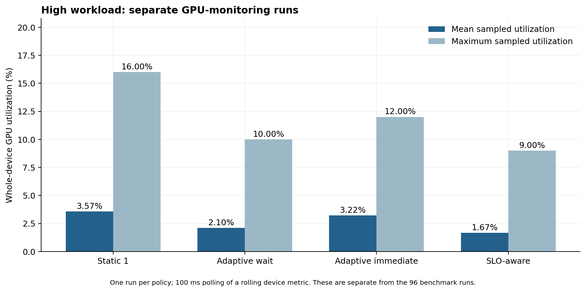

# GPU monitoring after the SLO extension

These four high-workload runs use the updated executable with service-time calibration and a 20 ms request budget. The SLO-aware policy uses a 10 ms safety margin. They are separate monitored runs, not the GPU measurements of the 96-run comparison.



| Policy | Mean sampled GPU utilization | Maximum sampled GPU utilization | Valid samples | SLO attainment in this monitored run |
| --- | ---: | ---: | ---: | ---: |
| Static 1 | 3.57% | 16% | 92 | 100.00% |
| Adaptive wait | 2.10% | 10% | 92 | 90.05% |
| Adaptive immediate | 3.22% | 12% | 92 | 100.00% |
| SLO-aware | 1.67% | 9% | 92 | 93.29% |

Each policy has one monitored run. These are descriptive measurements; they do not establish statistically reliable differences between policies. The number of GPU samples is not the number of independent experimental repeats.

## Verification and interpretation

Measurement-phase sample counts and mean utilization were recomputed from `gpu_samples.csv` and checked against metadata. Request counts and deadline-compliance counts were checked against `requests.csv`. All four runs were consistent.

Mean sampled utilization is low across all policies, consistent with an absence of sustained GPU saturation at this offered load. A lower utilization value does not by itself establish greater efficiency, better latency, or an advantage in capacity or energy use.

The monitor polls `nvidia-smi` every 100 ms. Utilization describes the whole GPU over the device's rolling sampling window. Samples can reflect other GPU work and are not independent 100 ms kernel-level measurements. Initialization and warm-up samples are excluded using host-received start/end markers; rolling-window and marker timing effects remain near the boundaries.

## Service-time prediction limitation

The SLO-aware monitored run completed 1998 requests, with 1864 within deadline and 134 violations. Of those violations, **133 had positive estimated slack at service start**. For these requests, the actual service duration exceeded the estimated remaining allowance: a positive prediction did not ensure timely completion. The remaining violation already had nonpositive slack at service start.

This directly shows the limitation of applying a fixed, warm-up-derived service estimate to the later serving workload. It does not identify which component of service time caused the mismatch. Service includes batch preparation and runtime work as well as GPU execution. These counts refer to this monitored run only and must not be projected onto all 96 unmonitored runs.

The measured SLO attainment of 93.29% is below the 95% requirement. This is consistent with the repeated comparison's high-workload failures, but is not an additional unprofiled repeat to pool into that comparison.

## Reproduce

From the repository root, with the four run-1 folders under `results/gpu_slo/`:

```bat
python scripts\plot_slo_gpu.py
```

This produces `results/slo_analysis/slo_gpu_high.png`, the SVG version, and `slo_gpu_summary.csv`. It reads existing measurements and does not rerun inference.
