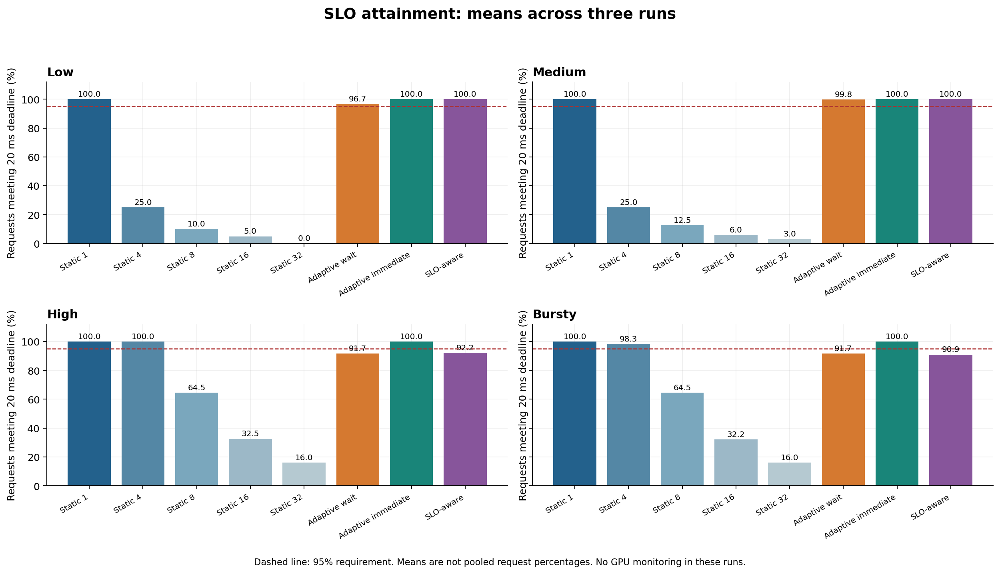
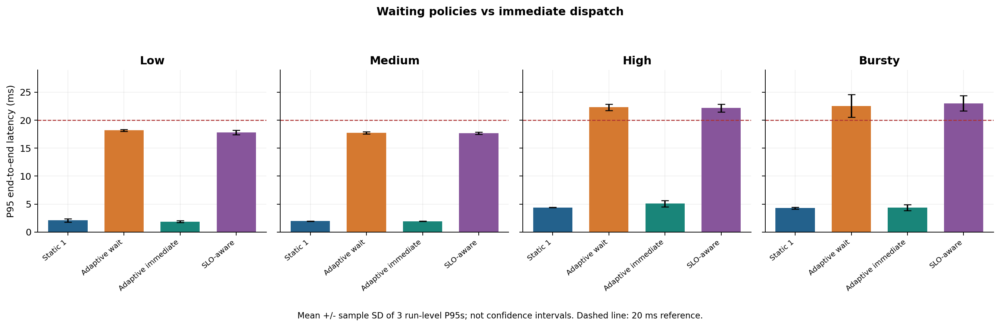
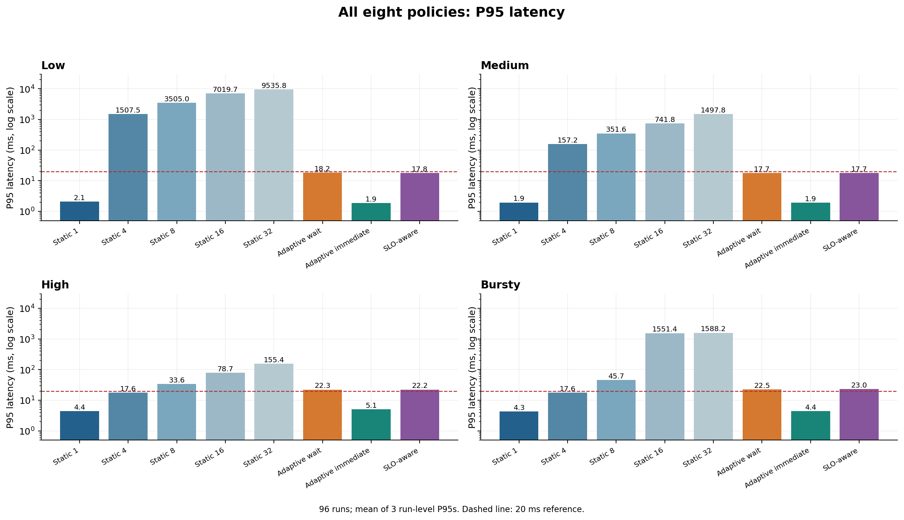
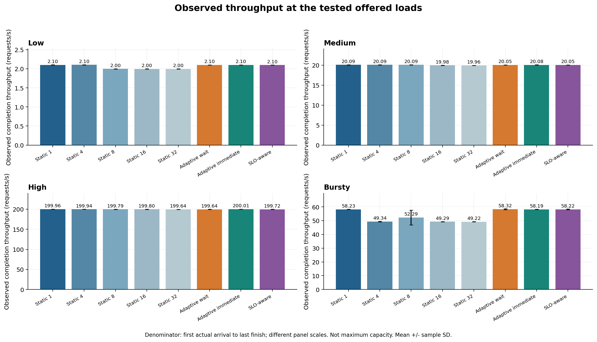

# SLO-aware scheduling: 96-run comparison

The SLO-aware policy met the experimental requirement in all three low and medium runs, but failed in all three high and bursty runs. Static batch 1 and Adaptive immediate met the requirement in every run across the four workloads. This experiment does not demonstrate an advantage of the SLO-aware policy over immediate dispatch.

## Configuration and validation

- Small FP32 wafer CNN on the existing C++ / ONNX Runtime CUDA pipeline.
- Eight policies: Static 1 / 4 / 8 / 16 / 32, Adaptive wait, Adaptive immediate, SLO-aware.
- Four workloads, three repeats per policy/workload: **96 runs, 32 groups**.
- Per-request latency target: **20 ms** from actual arrival to inference completion.
- Run-level requirement: at least **95%** of requests meet their deadlines.
- SLO scheduling safety margin: **10 ms**. Baseline CSVs also record this configuration, but baseline policies do not use the margin for dispatch.
- Adaptive wait retains its fixed 10 ms accumulation timeout. SLO-aware uses its computed deadline-based wait.
- Each run includes batch-size-specific calibration, excluded from serving metrics.
- The initial SLO smoke test used a 2 ms margin and failed on low. The margin was changed to 10 ms after that observation and fixed for these 96 runs. This is exploratory policy development, not an untouched holdout evaluation.

The submitted comparison contains 32 groups with exactly three runs each. Run-level P95, P99, throughput, SLO attainment means, and counts of passing runs were checked against the 96-row summary and agreed. Raw request-level and calibration files were not supplied for this analysis, so per-request flags and service estimates were not independently re-audited here. Formatting markers and HTML entities in the pasted files were removed before parsing; numerical values were retained.

## SLO attainment



The chart shows the arithmetic mean of three run-level attainment percentages. Run-level pass counts below preserve whether each individual run met the 95% requirement.

| Workload | Static 1 mean attainment | Adaptive wait | Adaptive immediate | SLO-aware | SLO-aware passing runs |
| --- | ---: | ---: | ---: | ---: | ---: |
| Low | 100.00% | 96.67% | 100.00% | 100.00% | 3/3 |
| Medium | 100.00% | 99.83% | 100.00% | 100.00% | 3/3 |
| High | 100.00% | 91.68% | 100.00% | 92.16% | 0/3 |
| Bursty | 100.00% | 91.68% | 100.00% | 90.92% | 0/3 |

Static 4 also passed all three high and bursty runs, with mean attainment of 99.98% and 98.31%. It failed all low and medium runs because sparse arrivals made batch accumulation costly. This illustrates why a fixed batch can be suitable at one offered load and unsuitable at another.

## Tail latency



| Workload | Static 1 P95 | Adaptive wait P95 | Adaptive immediate P95 | SLO-aware P95 |
| --- | ---: | ---: | ---: | ---: |
| Low | 2.090 ms | 18.180 ms | 1.863 ms | 17.806 ms |
| Medium | 1.948 ms | 17.732 ms | 1.917 ms | 17.674 ms |
| High | 4.402 ms | 22.318 ms | 5.077 ms | 22.174 ms |
| Bursty | 4.297 ms | 22.543 ms | 4.393 ms | 23.013 ms |

Values are means of three run-level P95s, not percentiles of pooled requests. Error bars are sample standard deviations, not confidence intervals. The 20 ms line is a visual reference; actual pass/fail uses request-level deadline flags, not rounded or interpolated percentile values.



Large fixed batches retain long batch-formation delays under sparse and bursty traffic. Adding SLO-aware dispatch limits those delays relative to large static batches, but immediate dispatch remains faster in this experiment.

SLO-aware mean run-level P99 is 18.301 ms for low, 18.053 ms for medium, 25.702 ms for high, and 25.842 ms for bursty. High and bursty miss both the request-level attainment goal and the 20 ms P95 reference in this session.

## Waiting, batching, and throughput

SLO-aware mean queue wait is approximately 15.57 ms on low and medium. Both workloads have mean actual batch size 1, so the intentional accumulation period does not produce additional batching there.

On high and bursty, SLO-aware mean actual batch sizes are approximately 3.18 and 3.14; Adaptive immediate averages approximately 1.11 and 1.10. Waiting creates larger batches, but there is no demonstrated throughput advantage at these offered loads.

Mean actual batch size here is requests divided by dispatched batches, calculated per run and then averaged. It is not the mean of a request-weighted size column.



SLO-aware observed throughput is approximately 2.099, 20.052, 199.724, and 58.217 requests/s for low, medium, high, and bursty respectively. These are first-arrival-to-last-completion measurements, not maximum capacity or uniformly measured full-window rates.

The bursty generator is configured for 200 requests/s during 500 ms active periods separated by 1500 ms inactive periods. Omitting the final inactive period from the throughput denominator can produce values above its ideal full-10-second average of 50 requests/s. Differences in completion time and batch flushing affect that denominator; they must not be described as equivalent gains in GPU processing capacity.

## What this adds to the project

The extension implements request deadlines, calibration-based service estimates, slack-based dispatch, and observed deadline compliance. Its limitations are experimentally visible: a policy can use deadline information and still miss the SLO.

The similar behavior of Adaptive wait and SLO-aware suggests that, under this model and configuration, the deadline-based policy often acts much like a short accumulation timeout. The aggregates alone cannot identify exact wake-up delays or service-estimation errors in this 96-run session. The earlier smoke test showed that positive estimated slack was insufficient to ensure a deadline was met, motivating further inspection rather than a guarantee claim.

No further margin tuning was performed within the reported comparison. A more compute-intensive model and a load sweep toward saturation would test whether forming larger batches can justify the waiting cost. Those are future experiments, not demonstrated benefits.

## GPU measurement status and limitations

**All 96 runs have GPU monitoring disabled.** Four separate high-workload GPU-monitoring runs have subsequently been collected using the updated executable. See [the GPU measurement analysis](slo_gpu_results.md). Those measurements must not be attached to the 96 benchmark runs as if measured simultaneously.

Only three repeats per group were collected; low has about 20 requests per run. The SLO target was selected using earlier baseline observations, and the margin was adjusted after a smoke test. Windows scheduling and calibration representativeness can affect outcomes. The policy is heuristic and does not provide a hard real-time guarantee. Input preprocessing is outside serving latency, while batch assembly and runtime overhead are inside service time. Request data reuse and absence of network serving also limit generalization.

## Reproduce charts

Keep the original `results/slo_comparison/summary.csv` and `comparison.csv`, then run from the repository root:

```bat
python scripts\plot_slo_results.py
```

This writes four PNG and four SVG charts under `results/slo_analysis/`. It reads the new 96-run session only and does not rerun inference or mix the earlier 84-run results.
